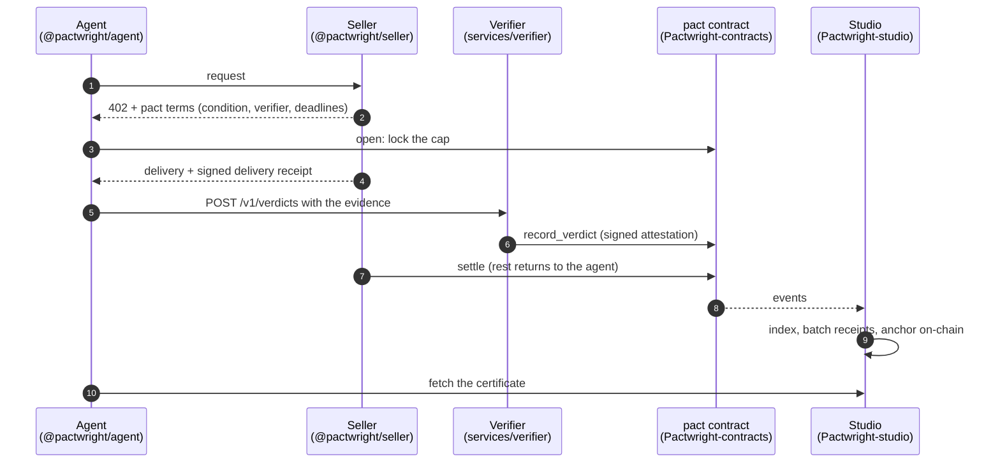

<p align="center">
  <picture>
    <source media="(prefers-color-scheme: dark)" srcset="brand/pactwright-logo-dark.svg">
    
  </picture>
</p>

<p align="center">
  <b>The TypeScript side of Pactwright: SDK, seller middleware, MCP tools and the verifier.</b><br>
  Everything an agent or a seller needs to use pacts, the escrow for AI-agent purchases on Stellar.
</p>

<p align="center">
  <a href="https://github.com/Pactwright/Pactwright-Kit/actions/workflows/ci.yml"></a>
  <a href="#testnet-evidence"></a>
  <a href="https://github.com/Pactwright/Pactwright-contracts"></a>
  <a href="#license"></a>
</p>

<p align="center">
  <a href="#in-60-seconds"><b>In 60 seconds</b></a> ·
  <a href="#how-the-pieces-fit"><b>How the pieces fit</b></a> ·
  <a href="#what-works-today"><b>What works today</b></a> ·
  <a href="#the-verifier"><b>The verifier</b></a> ·
  <a href="#license"><b>License</b></a> ·
  <a href="https://github.com/Pactwright/Pactwright-contracts">Contracts</a> ·
  <a href="https://github.com/Pactwright/Pactwright-studio">Studio</a>
</p>

<p align="center">
  <a href="https://scorecard.dev/viewer/?uri=github.com/Pactwright/Pactwright-Kit"></a>
</p>

> [!IMPORTANT]
> **Testnet only, not published yet.** Every MVP scenario runs as real Stellar testnet
> transactions through the Kit's own code, including full x402 purchases through Accensa's
> facilitator ([evidence](#testnet-evidence)). The facilitator's `pact` scheme is still in review
> and not hosted yet. [What works today](#what-works-today) shows each piece. Nothing is on npm yet.

## Contents

1. [In 60 seconds](#in-60-seconds)
2. [Why this exists](#why-this-exists)
3. [How the pieces fit](#how-the-pieces-fit)
4. [What works today](#what-works-today)
5. [Testnet evidence](#testnet-evidence)
6. [Packages](#packages)
7. [The verifier](#the-verifier)
8. [The core library](#the-core-library)
9. [Clone, build and test](#clone-build-and-test)
10. [Configuration](#configuration)
11. [Layout](#layout)
12. [Project status](#project-status)
13. [FAQ](#faq)
14. [Built on](#built-on)
15. [Contributing](#contributing)
16. [License](#license)

## In 60 seconds

- **What a pact is.** An AI agent's purchase held in escrow on Stellar. The buyer locks a cap, a verifier checks the delivery against a condition frozen before payment, and the seller is paid only what the verdict allows. The rest returns to the buyer. The contract is in [Pactwright-contracts](https://github.com/Pactwright/Pactwright-contracts) and runs on testnet.
- **What this repo is.** The off-chain code around that contract. It covers the agent that buys, the seller that sells, and the verifier that judges.
- **What runs today.** Hashing that matches the contract byte for byte, the verifier's rules, receipt checks and signing, the contract client, and the seller's on-chain refund and settle hooks. All seven MVP scenarios, plus two full x402 purchases, have run end to end on testnet: 18 real transactions, [linked below](#testnet-evidence).
- **How it's checked.** 335 tests of the Kit's own code run in CI, plus the 57 tests that ship with the vendored Witness core and Accensa SDK. Merkle proofs are tested against Accensa's conformance vectors. A nightly workflow repeats the testnet run.

## Why this exists

AI agents can already pay over HTTP with [x402](https://developers.stellar.org/docs/build/agentic-payments/x402):
the seller answers `402 Payment Required`, the agent pays in USDC and retries. But once the money
moves, the agent has no way to get it back if the delivery is wrong, partial or missing.

The [`pact` contract](https://github.com/Pactwright/Pactwright-contracts) fixes that on-chain. To use
it, though, an agent, a seller and a verifier each need code that speaks the same formats. They have
to hash the condition the same way, sign the same bytes and agree on what a delivery receipt is.
This kit is that shared code, so neither side has to re-implement the protocol and get a byte wrong.

| Who | What they get from the kit |
|---|---|
| **Agent builders** | `@pactwright/agent` and `@pactwright/mcp`: find a seller, open a pact, wait for the verdict and keep the certificate. Available as a library or as tools an LLM agent can call |
| **Sellers** | `@pactwright/seller`: one middleware call turns an x402 route into a pact-protected route with terms, delivery receipts and settlement |
| **Verifier operators** | `services/verifier`: a model reads the delivery, deterministic rules decide, and every verdict is a signed, re-checkable envelope |
| **Everyone** | `@pactwright/core`: the schemas, hashing, amounts and Merkle code all of the above share |

## How the pieces fit



1. The **seller middleware** answers `402` with the pact terms: the condition, the verifier's key and the deadlines.
2. The **agent** checks the terms, freezes the condition hash and opens the pact, which locks the cap in escrow.
3. The **seller** delivers and signs a receipt over the exact bytes delivered.
4. The **verifier** has a model read the delivery, applies deterministic rules, and signs a verdict envelope (Witness format) plus an on-chain attestation.
5. The **contract** pays the seller what the verdict allows and returns the rest.
6. **Studio** indexes the events and anchors a receipt, so the agent gets a certificate anyone can verify.

## What works today

| Piece | Status | What's there |
|---|---|---|
| `@pactwright/core` | ✅ Working | Schemas, exact amounts, Merkle proofs matching `ReceiptAnchor`, network config, and hashing (`pactId`, condition hash, signed messages) that matches the contract. The testnet run checks the Kit's `pact_id` against the contract's on every `open` |
| `@pactwright/contracts-client` | ✅ Working | Generated from the contract's bindings; used by the testnet run for `open`, `record_verdict` and `release` |
| `services/verifier` rules and signing | ✅ Working | `document.translation` and `code.review` rules, verdict-v1 envelopes, one attestation per pact. The contract accepts its signatures on testnet |
| `services/verifier` receipt checks | ✅ Working | Verifies the seller's ed25519 signature over the pact and body hash, and that the body is in the evidence |
| `services/verifier` model reading | ⚙️ Needs config | Provider-neutral adapter. Fails closed: with no provider, model and key configured, it refuses rather than inventing a reading |
| `services/verifier` HTTP service | ✅ Working | `/health`, `/v1/verdicts`, `/v1/envelopes/:sha256`; one verdict per pact and milestone |
| `@pactwright/seller` refund and settle hooks | ✅ Working | `RefundVault.refund` (M0, disputes) and `settle` (M2) sent as real transactions |
| `@pactwright/seller` middleware | ✅ Testnet | x402 v2 paywall: a valid 402, payments verified and settled by the facilitator before anything is served, `pact_id` derived from the verified payer, signed `X-Pactwright-Delivery`, one serve per pact (Express and Hono). No default payee, delivery key or verifier |
| `@pactwright/agent` accounts | 🧪 Tested offline | Sponsored agent accounts and top-ups, submitted through RPC; never returns the hash of an unsent transaction |
| `@pactwright/agent` buy | ✅ Testnet | x402: reads the 402, refuses terms that differ from the listing or the frozen condition, pays with `exact` (M0) or `pact` (M2), signing only auth entries |
| Facilitator `pact` scheme | 🚧 In review | Built in the Accensa facilitator ([#651](https://github.com/accensa/x402-facilitator-stellar/pull/651)) and used by the testnet run; no hosted facilitator yet |
| `@pactwright/mcp`, `@pactwright/cli` | 🧪 Tested offline | MCP tools and CLI commands; `buy` and `agent-*` inherit the status of the agent rows above |
| Adapters | ⚙️ Partner APIs | Vespi gate and Pollar wallet fail closed when their APIs are unreachable. Partner access is F-08 / F-09 |

## Testnet evidence

On 2026-10-29, every MVP scenario ran on Stellar testnet against the deployed
[`pact` contract](https://stellar.expert/explorer/testnet/contract/CDUXJJUNYFILEYHE3LITANJEKCDFERNAABOSG75OWATFVM776BCMFEV6) with real
testnet USDC and a fresh Accensa `RefundVault` ([`CCOYYFVZ…`](https://stellar.expert/explorer/testnet/contract/CCOYYFVZG3KA4JDPDZORTPR64QJWXO2YU2RORQ4ARA4W24YEVMG5GT3C)).
The Kit's own code did the work: core hashing, the verifier's rules and signing, the contract client,
and the seller's refund and settle hooks.

The two **x402** rows are the full purchase flow:
1. The Kit agent requests a resource from the Kit's `pact()` seller middleware and gets a 402.
2. The agent pays with its built-in x402 payment, signing only auth entries.
3. Accensa's x402 facilitator ([`pact` scheme](https://github.com/accensa/x402-facilitator-stellar/pull/651)) verifies the payment, pays the fee and settles it.
4. The seller serves the content with a delivery receipt, which is then checked like the verifier checks it.

For M2, the verdict and the seller's settle also go through the facilitator's `/pact/submit`.

| Scenario | Outcome | Step | Transaction |
|---|---|---|---|
| **M0 ALLOW** | ALLOW, seller keeps 1 | x402 exact payment to seller | [`d20c598d…`](https://stellar.expert/explorer/testnet/tx/d20c598dea58458f83a27f6c905191f72d2e81e86b6c9234cad19c230c79dee9) |
| **M0 DENY** | DENY, 1 refunded | x402 exact payment to seller | [`8fe40e82…`](https://stellar.expert/explorer/testnet/tx/8fe40e8263a221b5f731edd8b6fa01fd3ba31fe83c1f8630c603837d53ae4495) |
|  |  | RefundVault.refund | [`a2410a5a…`](https://stellar.expert/explorer/testnet/tx/a2410a5a3536a92ae352250f963f9f5970932b26f3ef6093d4fbba34a431dadf) |
| **M0 non-delivery** | DENY, 0.5 refunded | x402 exact payment to seller | [`cc807371…`](https://stellar.expert/explorer/testnet/tx/cc8073719a89b4798f82bbac7b88e6b4b50c0aadd294fcedbf9ae8fbfe8e76fa) |
|  |  | RefundVault.refund | [`4ee4b496…`](https://stellar.expert/explorer/testnet/tx/4ee4b49675f0be868145d21fa5bdcd740d925a09fd9ee66a2e2be8072373ba23) |
| **M2 ALLOW** | ALLOW 0.75 of 1, settled | open (1 USDC locked in escrow) | [`28064f6f…`](https://stellar.expert/explorer/testnet/tx/28064f6ff11a167a7da88165fa585e3e76f5d61a128ec98078005f0ff652af1a) |
|  |  | record_verdict (ALLOW 0.75, verifier-signed) | [`130da09f…`](https://stellar.expert/explorer/testnet/tx/130da09f02d142b1f3fedd1c0c7a57fb2c56430cca70af7f8c0c7852b4464f60) |
|  |  | settle (0.75 to seller, 0.25 back to buyer) | [`67d48bd3…`](https://stellar.expert/explorer/testnet/tx/67d48bd32ec1ce1898b5ff908aecf55d1fb1f2ab37b8fd3563e01a6790689cf8) |
| **M2 DENY** | DENY, full refund | open (1 USDC locked in escrow) | [`3bb94d92…`](https://stellar.expert/explorer/testnet/tx/3bb94d92c321b48395137cdacf09c18962b66cfd47d5ffb0699df86f8e693d23) |
|  |  | record_verdict (DENY, verifier-signed) | [`4876a9cb…`](https://stellar.expert/explorer/testnet/tx/4876a9cbcefea4155b5ee1830e62984762919bc7b24f4ff5ef9fa606adfd21c5) |
|  |  | release (1 USDC back to buyer) | [`50cef2fd…`](https://stellar.expert/explorer/testnet/tx/50cef2fdc1cede817c25934d36ddfebb5f2d42d3f978ddb2d1f9785f68218149) |
| **M2 silence** | no verdict, refunded by silence policy | open (1 USDC locked in escrow) | [`ced11714…`](https://stellar.expert/explorer/testnet/tx/ced11714739979083aa348793b361d350c6e935d5027e66a571e428b8700cf3e) |
|  |  | release after the verdict deadline (silence = Refund) | [`603d3e8b…`](https://stellar.expert/explorer/testnet/tx/603d3e8be222965c5d59ac202ad0af9cc74155d570978c7db63e187a2d8c759d) |
| **Dispute refund** | dispute-1: 2 of 4 pages, 0.5 refunded | RefundVault.refund (dispute-1) | [`85a7b40e…`](https://stellar.expert/explorer/testnet/tx/85a7b40eb77a73c046974a1f7b9dd673002df5e4f42bde068b34dffdcece5593) |
| **x402 M0 (exact)** | paid over x402, receipt verified | x402 exact payment (facilitator-paid fee) | [`a7da7309…`](https://stellar.expert/explorer/testnet/tx/a7da7309ebb4ecf6880c129b29002fe26503320132ca6e02d0126d248bfa9f0f) |
| **x402 M2 (pact)** | ALLOW 1, settled; every fee paid by the facilitator | x402 pact.open (facilitator-paid fee) | [`19fe0413…`](https://stellar.expert/explorer/testnet/tx/19fe0413cb94e2b23f12df83d19559f4a9a5ed0437a915c00e337027a09fbbf6) |
|  |  | record_verdict via /pact/submit | [`7fcf67b8…`](https://stellar.expert/explorer/testnet/tx/7fcf67b87f5d742966470d72f5ffbf7151b01159cad9512efe0cba8cd285d822) |
|  |  | settle via /pact/submit (seller-signed) | [`6aeb2fce…`](https://stellar.expert/explorer/testnet/tx/6aeb2fcef470847eb772cac95b9e725c3bb9e57a2466a92ca46505fd8dd26fdb) |

What isn't real here: the model's reading of each delivery is a fixture, so the verdict depends
only on the deterministic rules. The non-x402 rows send payments directly. The full report, with
buyer, seller and receipt leaves, is [`e2e/testnet/results/2026-10-29.json`](e2e/testnet/results/2026-10-29.json).

Run it yourself. The x402 rows need a facilitator with `PACT_CONTRACT_ID` set:

```bash
E2E_VERIFIER_SECRET=S… E2E_FACILITATOR_URL=http://localhost:3402 pnpm e2e:testnet
```

## Packages

| Package | For | Purpose |
|---|---|---|
| [`@pactwright/core`](packages/core) | Everyone | Schemas, hashing, Merkle, amounts, network config |
| [`@pactwright/contracts-client`](packages/contracts-client) | Agent, seller | Typed client for the `pact` contract |
| [`@pactwright/agent`](packages/agent) | Agent builders | Buyer runtime: find → buy → await → certificate, plus metered sessions |
| [`@pactwright/seller`](packages/seller) | Sellers | `pact(options)` middleware for x402 sellers |
| [`@pactwright/mcp`](packages/mcp) | LLM agents | MCP tools: `find_sellers`, `buy`, `get_pact`, `dispute`, `get_certificate` |
| [`@pactwright/adapters`](packages/adapters) | Integrators | Pluggable discovery, reputation, spending gate, wallet and verifier |
| [`@pactwright/cli`](packages/cli) | Operators | `pactwright verify`, `pact`, `agent-create`, `agent-topup` |
| [`services/verifier`](services/verifier) | Verifier operators | The Witness-compatible verifier service |

## The verifier

The verifier answers one question: did the delivery meet the condition the buyer and seller agreed
on before payment? Its design follows one rule from [Witness](https://github.com/fabian416/witness):
**the model reads, code decides.**

1. **The model reads.** An LLM turns the delivered document into a small structured reading, for example `{ detectedLanguage, pageCount, isTranslationOfSource, untranslatedSegments }`. It never decides anything.
2. **Code decides.** A pure rule function turns that reading and the frozen condition into ALLOW or DENY, plus an amount. The same inputs always give the same verdict, so anyone can re-run the rules on the stored reading.
3. **Everything is signed and kept.** The verdict is a Witness `verdict-v1` envelope. It records the criteria, reason codes, model ID and policy version, is signed with the verifier's key, and is retrievable by its hash.
4. **If the model refuses, there is no verdict.** The verifier doesn't guess. The pact falls back to its silence policy, which by default refunds the buyer.

### Example: `document.translation`

Condition, frozen before payment:

```json
{ "kind": "document.translation", "lang": "pt", "minPages": 4, "maxUntranslatedSegments": 0 }
```

| Criterion | Mandatory | Fails when |
|---|---|---|
| `language` | Yes | The detected language isn't the required one (`pt-BR` counts as `pt`) |
| `is_translation` | Yes | The document isn't a translation of the source |
| `completeness` | Yes | More untranslated segments than allowed |
| `has_pages` | Yes | Nothing was delivered |
| `page_count` | No | Fewer pages than `minPages` |

A failed mandatory criterion means DENY, and the buyer gets everything back. A short delivery is
paid pro rata: `cap × pages ÷ minPages`, rounded down. With a 1 USDC cap and 3 of 4 pages, the
seller is paid 0.75 USDC and 0.25 USDC returns to the buyer.

### HTTP API

| Method | Path | Returns |
|---|---|---|
| `GET` | `/health` | `ok`, and the verifier's public key as a Stellar address and as hex (the key sellers put in their terms) |
| `POST` | `/v1/verdicts` | `201` with the envelope, its reference, the amount and the attestation. `409` if this pact and milestone already have a verdict. `202` with no verdict if the model refused. `400` on invalid input |
| `GET` | `/v1/envelopes/:sha256` | A stored envelope, so anyone can check a verdict |

`POST /v1/verdicts` takes the pact `terms`, at least one `evidence` item, an optional seller
`deliveryReceipt`, and a `milestone` (`delivery`, or `dispute-<n>` for later disputes).

## The core library

```ts
import { toStroops, fromStroops, buildTree, verifyProof, loadNetworkConfig } from "@pactwright/core";

toStroops("1.25");        // 12500000n  (USDC has 7 decimals)
fromStroops(7500000n);    // "0.75"

const tree = buildTree([leafA, leafB, leafC]);          // 32-byte hex leaves
verifyProof(leafA, tree.proofs.get(leafA)!, tree.root); // true, same result as ReceiptAnchor.verify_receipt

const network = loadNetworkConfig(process.env);         // throws, listing every problem, if incomplete
```

Amounts are decimal strings in TypeScript and `i128` stroops on-chain. They're converted in only
one place, `amounts.ts`, so a rounding bug can't hide anywhere else.

## Clone, build and test

Requires Node.js 24 and pnpm.

```bash
git clone https://github.com/Pactwright/Pactwright-Kit.git && cd Pactwright-Kit
pnpm install
pnpm typecheck      # also builds the vendored Witness core
pnpm test           # 335 Kit tests + 57 vendored Witness and Accensa SDK tests
pnpm lint
```

## Configuration

Services refuse to start when configuration is missing or inconsistent, and they list every problem
at once. Copy [`.env.example`](.env.example) and fill in what you run:

| Group | Variables |
|---|---|
| Network (all) | `STELLAR_NETWORK`, `STELLAR_NETWORK_PASSPHRASE`, `STELLAR_RPC_URL`, `USDC_SAC_ID`, `PACT_CONTRACT_ID`, `RECEIPT_ANCHOR_ID` |
| Facilitator | `FACILITATOR_URL`, `FACILITATOR_API_KEY` |
| Agent | `AGENT_SECRET_KEY` (testnet only), `SPONSOR_SECRET_KEY` |
| Seller | `SELLER_DELIVERY_KEY`, `SELLER_SIGNING_KEY_REF`, `SELLER_REFUND_VAULT_ID` |
| Verifier | `VERIFIER_SECRET_KEY`, `VERIFIER_PROVIDER`, `VERIFIER_MODEL`, `VERIFIER_EFFORT`, `VERIFIER_LLM_API_KEY`, `EVIDENCE_BUCKET_URL` |

The testnet contract addresses are in [Pactwright-contracts/DEPLOYMENTS.md](https://github.com/Pactwright/Pactwright-contracts/blob/main/DEPLOYMENTS.md).
The verifier's model provider is configurable, and the provider, model ID and effort are recorded in
every envelope.

## Layout

| Path | What |
|---|---|
| [`packages/`](packages) | The publishable libraries listed above |
| [`services/verifier`](services/verifier) | The verifier service: `server.ts`, `rules/`, `models/`, `pipeline.ts` |
| [`vendor/witness-core`](vendor/witness-core) | `@witness/core`, vendored unmodified (see [UPSTREAM.md](vendor/witness-core/UPSTREAM.md)) |
| [`packages/core/test/vectors`](packages/core/test/vectors) | Conformance vectors: Pactwright's own and Accensa's Merkle vectors |
| [`e2e/testnet`](e2e/testnet) | The real testnet run of every MVP scenario, and its reports |
| [`examples/`](examples) | `agent-node`, `seller-express`, `metered-minutes` (filled in as the packages land) |
| [`docs/`](docs) | PRD, architecture, essentials, project structure |

## Project status

| Area | State |
|---|---|
| Core, contract client, verifier, seller hooks | Working, proven on testnet |
| Nightly testnet e2e | Workflow ready; needs the `TESTNET_VERIFIER_SECRET` repo secret (K-16) |
| Agent x402 payment | Working on testnet (K-08, K-09) |
| Facilitator `pact` scheme | In review: accensa/x402-facilitator-stellar#651 (X-01…X-08) |
| npm release | Not yet (K-17) |

[ROADMAP.md](ROADMAP.md) tracks every task and its progress. Every pull request updates it.

## FAQ

**Can I use this today?** On testnet, from this repo: the agent, the seller middleware, the verifier,
the contract client and the core library all work, as the [testnet evidence](#testnet-evidence) shows.
You need a facilitator with the `pact` scheme (run Accensa's locally until it's hosted). Nothing is on
npm yet.

**Why does the verifier use a model at all?** Because "is this a correct Portuguese translation?"
can't be checked by a hash. But the model only *reads*. The decision, and the amount paid, come from
plain rules you can audit and re-run.

**Which model does the verifier use?** It's configurable. The provider, model ID and reasoning effort
are recorded in every envelope, so a verdict can always be traced to what produced it.

**Does the verifier hold anyone's money?** No. It can only sign verdicts. The contract holds the
money, and a missing verdict falls back to the agreed silence policy.

**Why Apache-2.0 here when the contracts are MIT?** See [License](#license).

## Built on

| Project | What the kit uses | How |
|---|---|---|
| [Witness](https://github.com/fabian416/witness) | `verdict-v1` envelopes, criteria and reason codes, "model reads, code decides" | `@witness/core` vendored unmodified in `vendor/witness-core` |
| [Accensa](https://github.com/accensa) | `ReceiptAnchor` Merkle format, `RefundVault`, x402 facilitator | Merkle conformance vectors; M0 refunds and the facilitator `pact` scheme |
| [Vespi](https://github.com/andresanemic/vespi) | Human approval of agent spending | Budget-gate adapter (v1) |
| [BookerBob](https://github.com/hustle1hustle/bookerbob-hackmeridian-2026) | Proven-customer reputation | Reputation adapter (v2) |
| [Ficha](https://github.com/beto-rocha-blockchain/ficha-stellar) | Refunding unused units | Metered sessions with signed usage vouchers |
| [Pollar](https://docs.pollar.xyz) | Seedless wallets | Wallet adapter, through the public SDK only |

## Contributing

Read [CONTRIBUTING.md](CONTRIBUTING.md) and [AGENTS.md](AGENTS.md). Every pull request updates
[ROADMAP.md](ROADMAP.md): task status, progress counts and one Update log line. `main` is protected,
so pull requests need a review and green checks. Verifier signing code and the hashing module are
core-team paths (see `CODEOWNERS`).

## License

Pactwright-Kit is released under the **[Apache License 2.0](LICENSE)**.

```text
Copyright 2026 Pactwright contributors
```

### What Apache-2.0 means for you

| You may | You must | You get no |
|---|---|---|
| Use the code in open or closed-source projects, commercially or not | Include a copy of the license with any copy you distribute | Warranty of any kind |
| Modify it and distribute your changes | Mark files you changed with a notice that you changed them | Liability from the authors for losses, including funds lost through a bug |
| Sublicense and sell it | Keep the copyright, patent and attribution notices, including [NOTICE](NOTICE) | Right to use the Pactwright name or logo to endorse your product |
| Use any patents contributors hold on their contributions (explicit grant) | | Patent license if you sue anyone claiming the code infringes a patent (it ends) |

The no-warranty clause matters here because this code moves money and decides who gets paid. If you
run it, the risk is yours.

### Why Apache-2.0 and not MIT

The kit includes Witness core in [`vendor/witness-core`](vendor/witness-core), which is licensed under
Apache-2.0. Keeping the whole kit under Apache-2.0 means a single set of terms covers everything in
the repo, and it adds an explicit patent grant. That matters for an SDK that other companies build
products on. The contracts and Studio repos contain no Apache-2.0 code, so they use MIT.

| Repository | License |
|---|---|
| [Pactwright-contracts](https://github.com/Pactwright/Pactwright-contracts) | MIT |
| Pactwright-Kit (this repo) | Apache-2.0 |
| [Pactwright-studio](https://github.com/Pactwright/Pactwright-studio) | MIT |

### Third-party code and licenses

| Component | How it is used | License |
|---|---|---|
| [`@witness/core`](https://github.com/fabian416/witness) (commit `1f9a8e2`) | Vendored unmodified in `vendor/witness-core`. It has its own LICENSE and NOTICE, and [UPSTREAM.md](vendor/witness-core/UPSTREAM.md) records the exact source | Apache-2.0 |
| Accensa Merkle conformance vectors | Test data in `packages/core/test/vectors/accensa` | MIT |
| `@accensa/sdk` | Vendored in `vendor/accensa-sdk`; the seller's settle hook | MIT |
| Accensa `refund_vault.wasm` v0.2.0 | Test fixture in `e2e/testnet/fixtures`, hash-checked; deployed fresh by each testnet run | MIT |
| [zod](https://www.npmjs.com/package/zod) 4 | Schemas and validation | MIT |
| [hono](https://www.npmjs.com/package/hono), [@hono/node-server](https://www.npmjs.com/package/@hono/node-server) | The verifier's HTTP server | MIT |
| [@stellar/stellar-base](https://www.npmjs.com/package/@stellar/stellar-base) 15 | Keys and signatures (via Witness core) | Apache-2.0 |
| [@stellar/stellar-sdk](https://www.npmjs.com/package/@stellar/stellar-sdk) 16 | RPC, transactions and the contract client | Apache-2.0 |
| [@x402/core](https://www.npmjs.com/package/@x402/core), [@x402/stellar](https://www.npmjs.com/package/@x402/stellar) | x402 v2 headers and facilitator client (seller); x402 client and the `exact` scheme (agent) | Apache-2.0 |
| TypeScript, Vitest, ESLint, Prettier, Changesets | Development only, not shipped | Apache-2.0 / MIT |

Ideas used without copying code (Ficha, Vespi, BookerBob) and the Pollar integration (public SDK
only; Pollar Studio has no license, so none of its code is used) are credited in [NOTICE](NOTICE).

### Contributing under this license

Under section 5 of the license, anything you submit in a pull request is licensed under Apache-2.0,
the same as the rest of the repo. There is no separate contributor license agreement.
