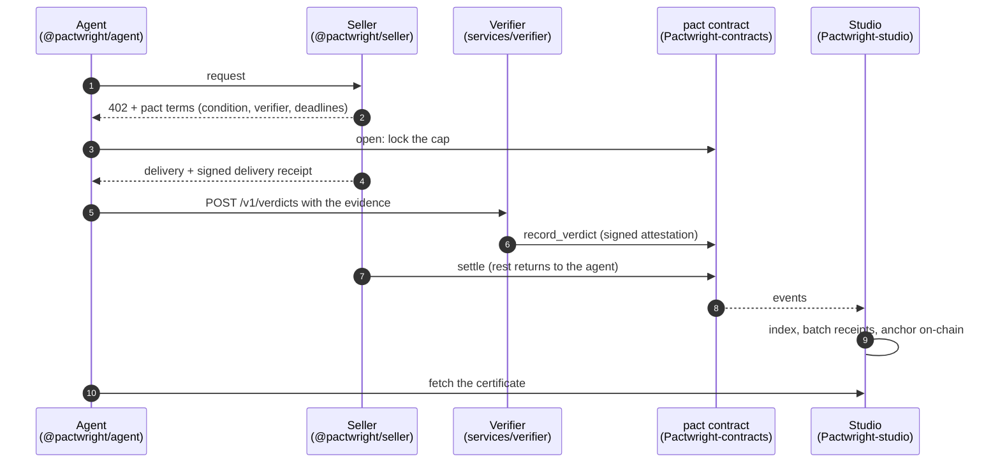

<p align="center">
  <picture>
    <source media="(prefers-color-scheme: dark)" srcset="brand/pactwright-logo-dark.svg">
    
  </picture>
</p>

<p align="center">
  <b>The TypeScript side of Pactwright: SDK, seller middleware, MCP tools and the verifier.</b><br>
  Everything an agent or a seller needs to use pacts, the escrow for AI-agent purchases on Stellar.
</p>

<p align="center">
  <a href="https://github.com/Pactwright/Pactwright-Kit/actions/workflows/ci.yml"></a>
  <a href="LICENSE"></a>
  <a href="https://scorecard.dev/viewer/?uri=github.com/Pactwright/Pactwright-Kit"></a>
</p>

<p align="center">
  <a href="https://pactwright.github.io/docs/"><strong>Documentation</strong></a> ·
  <a href="#-quick-start"><strong>Quick start</strong></a> ·
  <a href="#-testnet-evidence"><strong>Evidence</strong></a>
  <!-- demo: add a Docs · Dashboard · Demo link row here when a screencast or a public dashboard exists -->
</p>

> [!IMPORTANT]
> **Testnet only, not published yet.** Every MVP scenario runs as real Stellar testnet transactions
> through the Kit's own code, including full x402 purchases through Accensa's hosted facilitator, and
> a verdict from the hosted verifier has been accepted on-chain ([evidence](#-testnet-evidence)).
> Nothing is on npm: [`.github/workflows/release.yml`](.github/workflows/release.yml) still has its
> publish line commented out (ROADMAP K-17). The safest first read is
> [Testnet evidence](#-testnet-evidence), then
> [What "Supported" means here](#what-supported-means-here) for what CI actually proves.

## Contents

1. [Overview](#-overview)
2. [Architecture](#️-architecture)
3. [Test fixtures and the eval set](#-test-fixtures-and-the-eval-set)
4. [Testnet evidence](#-testnet-evidence)
5. [The hosted verifier](#the-hosted-verifier)
6. [Supported Versions & Compatibility](#️-supported-versions--compatibility)
7. [What "Supported" means here](#what-supported-means-here)
8. [Compatibility matrix](#compatibility-matrix)
9. [Quick Start](#-quick-start)
10. [1. Installation](#1-installation)
11. [2. Configuration](#2-configuration)
12. [3. Usage](#3-usage)
13. [Measurements](#-measurements)
14. [Community & Maintainers](#-community--maintainers)
15. [Contributing](#️-contributing)
16. [Contributors](#‍-contributors)
17. [License](#license)
18. [What Apache-2.0 means for you](#what-apache-20-means-for-you)
19. [Why Apache-2.0 and not MIT](#why-apache-20-and-not-mit)
20. [Third-party code and licenses](#third-party-code-and-licenses)
21. [Contributing under this license](#contributing-under-this-license)

## 📖 Overview

A pact is an AI agent's purchase held in escrow on Stellar. The buyer locks a cap, a verifier checks
the delivery against a condition frozen before payment, and the seller is paid only what the verdict
allows. The rest returns to the buyer. The contract itself is in
[Pactwright-contracts](https://github.com/Pactwright/Pactwright-contracts) and runs on testnet.

AI agents can already pay over HTTP with [x402](https://developers.stellar.org/docs/build/agentic-payments/x402):
the seller answers `402 Payment Required`, the agent pays in USDC and retries. Once the money has
moved, though, the agent has no way to get it back if the delivery is wrong, partial or missing. The
`pact` contract fixes that on-chain. To use it, an agent, a seller and a verifier each need code that
speaks the same formats: they have to hash the condition the same way, sign the same bytes and agree
on what a delivery receipt is. This kit is that shared code, so neither side re-implements the
protocol and gets a byte wrong.

What runs today is the path money takes: hashing that matches the contract byte for byte, the
verifier's rules, receipt checks and signing, the contract client, and the seller's on-chain refund
and settle hooks. All seven MVP scenarios plus two full x402 purchases have run end to end on testnet
as 18 real transactions, [linked below](#-testnet-evidence). The rest — the agent's account
sponsoring, the MCP tools and the CLI — is tested offline.

How it is checked: `pnpm test` measured **418 passed | 3 skipped (421 tests) across 45 test files** on
2026-10-30, the vendored Witness and Accensa suites included, and Merkle proofs are tested against
Accensa's conformance vectors. A nightly workflow repeats the testnet run. The full documentation is
at **[pactwright.github.io/docs](https://pactwright.github.io/docs/)**.

| Who | What they get from the kit |
|---|---|
| **Agent builders** | `@pactwright/agent` and `@pactwright/mcp`: find a seller, open a pact, wait for the verdict and keep the certificate. Available as a library or as tools an LLM agent can call |
| **Sellers** | `@pactwright/seller`: one middleware call turns an x402 route into a pact-protected route with terms, delivery receipts and settlement |
| **Verifier operators** | `services/verifier`: a model reads the delivery, deterministic rules decide, and every verdict is a signed, re-checkable envelope |
| **Everyone** | `@pactwright/core`: the schemas, hashing, amounts and Merkle code all of the above share |

The kit builds on six projects rather than inventing their formats:

| Project | What the kit uses | How |
|---|---|---|
| [Witness](https://github.com/fabian416/witness) | `verdict-v1` envelopes, criteria and reason codes, "model reads, code decides" | `@witness/core` vendored unmodified in [`vendor/witness-core`](vendor/witness-core) |
| [Accensa](https://github.com/accensa) | `ReceiptAnchor` Merkle format, `RefundVault`, x402 facilitator | Merkle conformance vectors; M0 refunds and the facilitator `pact` scheme |
| [Vespi](https://github.com/andresanemic/vespi) | Human approval of agent spending | Budget-gate adapter (v1) |
| [BookerBob](https://github.com/hustle1hustle/bookerbob-hackmeridian-2026) | Proven-customer reputation | Reputation adapter (v2) |
| [Ficha](https://github.com/beto-rocha-blockchain/ficha-stellar) | Refunding unused units | Metered sessions with signed usage vouchers |
| [Pollar](https://docs.pollar.xyz) | Seedless wallets | Wallet adapter, through the public SDK only |

### 🏗️ Architecture



In order:

1. The **seller middleware** answers `402` with the pact terms: the condition, the verifier's key and the deadlines.
2. The **agent** checks the terms, freezes the condition hash and opens the pact, which locks the cap in escrow.
3. The **seller** delivers and signs a receipt over the exact bytes delivered.
4. The **verifier** has a model read the delivery, applies deterministic rules, and signs a verdict envelope (Witness format) plus an on-chain attestation.
5. The **contract** pays the seller what the verdict allows and returns the rest.
6. **Studio** indexes the events and anchors a receipt, so the agent gets a certificate anyone can verify.

The components, and what each one actually does:

1. **[`@pactwright/core`](packages/core)** — schemas, hashing, Merkle, amounts, network config.
   - Hashing (`pactId`, condition hash, signed messages) matches the contract; the testnet run checks the Kit's `pact_id` against the contract's on every `open`.
   - Amounts are decimal strings in TypeScript and `i128` stroops on-chain, converted in only one place, `amounts.ts`, so a rounding bug cannot hide elsewhere.
   - `loadNetworkConfig` throws and lists every problem at once when the network configuration is incomplete.
2. **[`@pactwright/contracts-client`](packages/contracts-client)** — typed client for the `pact` contract.
   - Generated from the contract's release bindings ([`scripts/fetch-bindings.sh`](scripts/fetch-bindings.sh), [`scripts/check-bindings.sh`](scripts/check-bindings.sh)).
   - Used by the testnet run for `open`, `record_verdict` and `release`, and by the verifier's submit path through the facilitator's `/pact/submit`.
3. **[`@pactwright/seller`](packages/seller)** — the `pact(options)` middleware for x402 sellers, in Express and Hono forms.
   - Builds a valid x402 v2 `402` with the pact terms, verifies and settles the payment through the facilitator before serving anything, derives `pact_id` from the verified payer, signs `X-Pactwright-Delivery`, and serves one pact once.
   - Refund and settle hooks: `RefundVault.refund` (M0, disputes) and `settle` (M2), sent as real transactions; the signing key comes from a KMS (`KMS_KEY_ID`) or, for development only, `SELLER_SECRET_KEY`.
   - No default payee, delivery key or verifier: it refuses to start rather than guess one.
4. **[`@pactwright/agent`](packages/agent)** — the buyer runtime: find, buy, await, certificate, plus metered sessions.
   - `buy` reads the `402`, refuses terms that differ from the listing or the frozen condition, and pays with `exact` (M0) or `pact` (M2), signing only auth entries.
   - `accounts.ts` creates sponsored agent accounts (CAP-33 reserves plus a USDC trustline) and tops them up through RPC, and never returns the hash of an unsent transaction.
5. **[`@pactwright/mcp`](packages/mcp) and [`@pactwright/cli`](packages/cli)** — the same runtime exposed to an LLM and to an operator.
   - MCP tools: `find_sellers`, `buy`, `get_pact`, `dispute`, `get_certificate`.
   - CLI commands: `pactwright verify`, `pact`, `agent-create`, `agent-topup`.
6. **[`@pactwright/adapters`](packages/adapters)** — pluggable discovery, reputation, spending gate, wallet and verifier.
   - The Vespi gate and the Pollar wallet fail closed when their APIs are unreachable; neither has been exercised against the partner's real API (ROADMAP F-08 / F-09).
7. **[`services/verifier`](services/verifier)** — the Witness-compatible verifier service, and the trust boundary of the whole protocol.
   - A provider-neutral model adapter, deterministic rule functions, and a Hono HTTP service backed by a Postgres envelope store.
   - It holds no money and can only sign verdicts. The contract holds the funds, and a missing verdict falls back to the agreed silence policy, which by default refunds the buyer.

**How the verifier decides.** Its design follows one rule from
[Witness](https://github.com/fabian416/witness): **the model reads, code decides.** A model is needed
because "is this a correct Portuguese translation?" cannot be checked by a hash — but the model only
*reads*, and the decision and the amount come from plain rules anyone can audit and re-run.

1. **The model reads.** An LLM turns the delivered document into a small structured reading, for example `{ detectedLanguage, pageCount, isTranslationOfSource, untranslatedSegments }`. It never decides anything.
2. **Code decides.** A pure rule function turns that reading and the frozen condition into ALLOW or DENY, plus an amount. The same inputs always give the same verdict, so anyone can re-run the rules on the stored reading.
3. **Everything is signed and kept.** The verdict is a Witness `verdict-v1` envelope. It records the criteria, reason codes, model ID and policy version, is signed with the verifier's key, and is retrievable by its hash. Envelopes live in Postgres, so their links keep resolving after a restart or redeploy.
4. **If the model refuses, there is no verdict.** The verifier doesn't guess. The pact falls back to its silence policy.

Example: `document.translation`. The condition is frozen before payment:

```json
{ "kind": "document.translation", "lang": "pt", "minPages": 4, "maxUntranslatedSegments": 0 }
```

| Criterion | Mandatory | Fails when |
|---|---|---|
| `language` | Yes | The detected language isn't the required one (`pt-BR` counts as `pt`) |
| `is_translation` | Yes | The document isn't a translation of the source |
| `completeness` | Yes | More untranslated segments than allowed |
| `has_pages` | Yes | Nothing was delivered |
| `page_count` | No | Fewer pages than `minPages` |

A failed mandatory criterion means DENY, and the buyer gets everything back. A short delivery is
paid pro rata: `cap × pages ÷ minPages`, rounded down. With a 1 USDC cap and 3 of 4 pages, the
seller is paid 0.75 USDC and 0.25 USDC returns to the buyer. `code.review` is the second condition
kind.

**Status per piece.**

| Piece | Status | What's there |
|---|---|---|
| `@pactwright/core` | Working | Schemas, exact amounts, Merkle proofs matching `ReceiptAnchor`, network config, and hashing that matches the contract. The testnet run checks the Kit's `pact_id` against the contract's on every `open` |
| `@pactwright/contracts-client` | Working | Generated from the contract's bindings; used by the testnet run for `open`, `record_verdict` and `release` |
| `services/verifier` rules and signing | Working | `document.translation` and `code.review` rules, verdict-v1 envelopes, one attestation per pact. The contract accepts its signatures on testnet |
| `services/verifier` receipt checks | Working | Verifies the seller's ed25519 signature over the pact and body hash, and that the body is in the evidence |
| `services/verifier` model reading | Real model | Provider-neutral adapter (OpenAI-compatible API), with timeouts and bounded retries. Fails closed: with no provider, model and key configured, it refuses rather than inventing a reading. **Real-model accuracy: 29/29 (100%)** on the labelled `document.translation` set with Google `gemini-3.5-flash-lite`, 2026-10-29 ([run](https://github.com/Pactwright/Pactwright-Kit/actions/runs/40897633766)) |
| `services/verifier` HTTP service | Working | `/health`, `/v1/verdicts`, `/v1/envelopes/:sha256`; one verdict per pact and milestone. Envelopes are kept in Postgres, so their links, which point at the service itself, keep resolving after a restart |
| Hosted verifier | Testnet | [`pactwright-verifier-testnet.onrender.com`](https://pactwright-verifier-testnet.onrender.com/health). A verdict it signed with the real model was accepted by `record_verdict` and settled ([evidence](#the-hosted-verifier)) |
| `@pactwright/seller` refund and settle hooks | Working | `RefundVault.refund` (M0, disputes) and `settle` (M2) sent as real transactions. A refund has been signed by a HashiCorp Vault transit key, so the seller key never leaves the KMS (`pnpm e2e:kms`) |
| `@pactwright/seller` middleware | Testnet | x402 v2 paywall: a valid 402, payments verified and settled by the facilitator before anything is served, `pact_id` derived from the verified payer, signed `X-Pactwright-Delivery`, one serve per pact (Express and Hono). No default payee, delivery key or verifier |
| `@pactwright/agent` accounts | Tested offline | Sponsored agent accounts and top-ups, submitted through RPC; never returns the hash of an unsent transaction |
| `@pactwright/agent` buy | Testnet | x402: reads the 402, refuses terms that differ from the listing or the frozen condition, pays with `exact` (M0) or `pact` (M2), signing only auth entries |
| Facilitator `pact` scheme | Testnet | Merged in Accensa's facilitator ([#651](https://github.com/accensa/x402-facilitator-stellar/pull/651)) and hosted on testnet; the testnet run's x402 rows go through it |
| `@pactwright/mcp`, `@pactwright/cli` | Tested offline | MCP tools and CLI commands; `buy` and `agent-*` inherit the status of the agent rows above |
| Adapters | Partner APIs | Vespi gate and Pollar wallet fail closed when their APIs are unreachable. Partner access is F-08 / F-09 |

**Repository layout.**

| Path | What |
|---|---|
| [`packages/`](packages) | The publishable libraries listed above |
| [`services/verifier`](services/verifier) | The verifier service: `server.ts`, `rules/`, `models/`, `pipeline.ts` |
| [`vendor/witness-core`](vendor/witness-core) | `@witness/core`, vendored unmodified (see [UPSTREAM.md](vendor/witness-core/UPSTREAM.md)) |
| [`packages/core/test/vectors`](packages/core/test/vectors) | Conformance vectors: Pactwright's own and Accensa's Merkle vectors |
| [`e2e/testnet`](e2e/testnet) | The real testnet run of every MVP scenario, and its reports |
| [`examples/`](examples) | `agent-node`, `seller-express`, `metered-minutes` |
| [`docs/`](docs) | PRD, architecture, essentials, project structure |

### 🧪 Test fixtures and the eval set

Four layers, each with a different claim to keep it honest.

- **Unit and integration suite** — `pnpm test`. Measured on 2026-10-30: **418 passed | 3 skipped
  (421 tests) across 45 test files**, including the suites that ship with the vendored Witness core
  and Accensa SDK. The 3 skipped tests are the Postgres-backed envelope store; they run in CI, which
  starts a Postgres service and sets `TEST_DATABASE_URL`.
- **Hashing conformance** — [`packages/core/test/vectors`](packages/core/test/vectors). `pactwright/`
  holds this project's vectors (`pact_id`, `condition_hash`, `delivery_receipt`, `receipt_leaf`,
  `usage_voucher`, `verdict_attestation`, `nonce`, `merkle`), `accensa/` holds Accensa's Merkle
  vectors. [`vectors.yml`](.github/workflows/vectors.yml) runs them on every pull request against the
  pinned contracts release, so a byte difference fails CI rather than the network.
- **Rules eval** — [`services/verifier/eval/cases/document-translation`](services/verifier/eval/cases/document-translation):
  52 labelled ALLOW/DENY cases, scored by `pnpm eval` on every push and pull request. It gates on
  ≥ 90%. Because it scores the rules against hand-written readings, it says nothing about the model.
- **Real-model eval** — [`services/verifier/eval/real`](services/verifier/eval/real): 29 labelled
  `document.translation` cases built from real documents (an English source, human translations in
  8 languages, unrelated texts), pushed through the full pipeline with the configured model. It costs
  money, so [`verifier-eval.yml`](.github/workflows/verifier-eval.yml) runs it on demand and weekly,
  never per PR, and fails below 90%.
- **Testnet end-to-end** — [`e2e/testnet`](e2e/testnet): every MVP scenario as real transactions,
  plus [`kms.e2e.ts`](e2e/testnet/kms.e2e.ts) and [`hosted-verifier.e2e.ts`](e2e/testnet/hosted-verifier.e2e.ts).
  [`e2e-testnet.yml`](.github/workflows/e2e-testnet.yml) runs it nightly and builds its job summary
  from the run's own report; nothing in the summary is hard-coded.

What these fixtures cannot see: the quality of a model reading outside the translation set, the real
Vespi and Pollar APIs (F-08 / F-09), pubnet behaviour, and anything about the contracts themselves,
which are tested in [Pactwright-contracts](https://github.com/Pactwright/Pactwright-contracts).

## 📊 Testnet evidence

On 2026-10-29, every MVP scenario ran on Stellar testnet against the deployed
[`pact` contract](https://stellar.expert/explorer/testnet/contract/CDUXJJUNYFILEYHE3LITANJEKCDFERNAABOSG75OWATFVM776BCMFEV6)
with real testnet USDC
([`CBIELTK6…DAMA`](https://stellar.expert/explorer/testnet/contract/CBIELTK6YBZJU5UP2WWQEUCYKLPU6AUNZ2BQ4WWFEIE3USCIHMXQDAMA))
and a fresh Accensa `RefundVault`
([`CA77XYHJ…36SR`](https://stellar.expert/explorer/testnet/contract/CA77XYHJAHRA6MRQVLN276RDWI6UU6X5GEV6ED24AXJAFEBYQVZ236SR)),
deployed by the run itself. The Kit's own code did the work: core hashing, the verifier's rules and
signing, the contract client, and the seller's refund and settle hooks. The addresses above are the
ones recorded in the run's report; every run deploys its own vault, so they change each night.

The two **x402** rows are the full purchase flow:

1. The Kit agent requests a resource from the Kit's `pact()` seller middleware and gets a 402.
2. The agent pays with its built-in x402 payment, signing only auth entries.
3. Accensa's x402 facilitator, hosted on testnet at `https://pactwright-facilitator-testnet.onrender.com` with the [`pact` scheme](https://github.com/accensa/x402-facilitator-stellar/pull/651), verifies the payment, pays the fee and settles it.
4. The seller serves the content with a delivery receipt, which is then checked like the verifier checks it.

For M2, the verdict and the seller's settle also go through the facilitator's `/pact/submit`.

| Scenario | Outcome | Step | Transaction |
|---|---|---|---|
| **M0 ALLOW** | ALLOW, seller keeps 1 | x402 exact payment to seller | [`38509ae3…`](https://stellar.expert/explorer/testnet/tx/38509ae3c467052fe517a7303543efc69e8fc9e1ae32022d31e729df3613b398) |
| **M0 DENY** | DENY, 1 refunded | x402 exact payment to seller | [`1b639eab…`](https://stellar.expert/explorer/testnet/tx/1b639eab020686ab11cf02961c53ae5aa2dc8dbd8afeab7aafc935a76f192bfb) |
|  |  | RefundVault.refund | [`2bc4f53d…`](https://stellar.expert/explorer/testnet/tx/2bc4f53d42160e6b03bdd53e818824c8a8634ad904f4ea2608f99510dbf579a3) |
| **M0 non-delivery** | DENY, 0.5 refunded | x402 exact payment to seller | [`b3b37888…`](https://stellar.expert/explorer/testnet/tx/b3b378880ea29951cd3185354e6542d6d6c6ec5dcfbe15a5fcdb263373e66441) |
|  |  | RefundVault.refund | [`d9b68052…`](https://stellar.expert/explorer/testnet/tx/d9b68052f92b3c108578d979e7625b9478c4934ca84e213838009100162794bc) |
| **M2 ALLOW** | ALLOW 0.75 of 1, settled | open (1 USDC locked in escrow) | [`a774fa79…`](https://stellar.expert/explorer/testnet/tx/a774fa79daa77a4eca3946aa52e137041b2743568ee2f96c9c0ceec1bbe10b6f) |
|  |  | record_verdict (ALLOW 0.75, verifier-signed) | [`15263e7c…`](https://stellar.expert/explorer/testnet/tx/15263e7cfd4b206b350aa3fc97e200e76984f07b7fde4b0dc5ed54d41c009dec) |
|  |  | settle (0.75 to seller, 0.25 back to buyer) | [`18ea30d9…`](https://stellar.expert/explorer/testnet/tx/18ea30d9838dbbaa774aeffc44c55abc91e79fc69659fcc81b73fda4f2b05496) |
| **M2 DENY** | DENY, full refund | open (1 USDC locked in escrow) | [`9a49c8fa…`](https://stellar.expert/explorer/testnet/tx/9a49c8fa14469a8ce788133d42b6d01d1b8091598ff8b13a9d45fe55a43768ce) |
|  |  | record_verdict (DENY, verifier-signed) | [`d53cc633…`](https://stellar.expert/explorer/testnet/tx/d53cc6336940ff01b7af6caab8f39dc8bd12ab43fda8eee76d52e355809e096a) |
|  |  | release (1 USDC back to buyer) | [`eae7c711…`](https://stellar.expert/explorer/testnet/tx/eae7c7118268818c9ff700a724647c0713295bd74e945f89f9c1aece572c7bcc) |
| **M2 silence** | no verdict, refunded by silence policy | open (1 USDC locked in escrow) | [`105581ce…`](https://stellar.expert/explorer/testnet/tx/105581cea5979e0c03a3bc635c2f55ffe8efe5f62a58a078004a597bab621d03) |
|  |  | release after the verdict deadline (silence = Refund) | [`2a4c579d…`](https://stellar.expert/explorer/testnet/tx/2a4c579d95861cbd4d6ae39e3d6d7956f5083fe5e16df20ee0a1d6224aee84fb) |
| **Dispute refund** | dispute-1: 2 of 4 pages, 0.5 refunded | RefundVault.refund (dispute-1) | [`79d22019…`](https://stellar.expert/explorer/testnet/tx/79d22019715f76cd500b85c1581415cad02878ec44d623fd5d35666a83b014b6) |
| **x402 M0 (exact)** | paid over x402, receipt verified | x402 exact payment (facilitator-paid fee) | [`f59c4181…`](https://stellar.expert/explorer/testnet/tx/f59c4181d418da5723255e61a8acdd37f11cdb40e9a3d3c5b07850ee7dce91be) |
| **x402 M2 (pact)** | ALLOW 1, settled; every fee paid by the facilitator | x402 pact.open (facilitator-paid fee) | [`a33591a1…`](https://stellar.expert/explorer/testnet/tx/a33591a1768b548516f1222d34167a37c17069eb377073f50e07f26cef8071b5) |
|  |  | record_verdict via /pact/submit | [`9d63a621…`](https://stellar.expert/explorer/testnet/tx/9d63a621dda5573a36a8eb2e8aab0f2715a14674e9804691799b0ca1b82fe895) |
|  |  | settle via /pact/submit (seller-signed) | [`51d659e4…`](https://stellar.expert/explorer/testnet/tx/51d659e4ee18c066088ec922202b3380d179909d2f8745f09b25f5878a2cb073) |

What isn't real here: in this run the model's reading of each delivery is a fixture, so the verdict
depends only on the deterministic rules, and the non-x402 rows send their payments directly rather
than over x402. A run with a real model reading is [the hosted verifier](#the-hosted-verifier). The
full report, with buyer, seller and receipt leaves, is
[`e2e/testnet/results/2026-10-29.json`](e2e/testnet/results/2026-10-29.json).

Run it yourself. The nightly workflow runs it too, x402 rows included, against the hosted facilitator:

```bash
E2E_VERIFIER_SECRET=S… E2E_FACILITATOR_URL=https://pactwright-facilitator-testnet.onrender.com pnpm e2e:testnet
```

**Seller key in a KMS.** On the same date a `RefundVault` refund was signed through HashiCorp Vault
transit (ed25519, non-exportable), so the merchant key never left the KMS; the transaction's only
signature is the Vault key's. Report:
[`e2e/testnet/results/kms-2026-10-29.json`](e2e/testnet/results/kms-2026-10-29.json), refund
[`fcb0d7a8…`](https://stellar.expert/explorer/testnet/tx/fcb0d7a88dcc826c8725934f47076f8d5ffffa6180acf3dd76b0d017d7d001be)
at ledger 5451648. Reproduce with `VAULT_ADDR=… VAULT_TOKEN=… KMS_KEY_ID=vault:… pnpm e2e:kms`.

### The hosted verifier

On 2026-10-29 the hosted verifier judged a real purchase with its real model (Google
`gemini-3.5-flash-lite`), and the contract accepted its signature. The script opened an escrow pact
with fresh accounts, committed the source and the delivered Portuguese translation to the public
[evidence store](https://github.com/Pactwright/pactwright-evidence), asked
`pactwright-verifier-testnet.onrender.com` for a verdict, then recorded it and settled. The script
never holds the verifier key, so the contract accepting the attestation shows the hosted service
signed it.

| Step | Ledger | Transaction |
|---|---|---|
| `open` (1 USDC locked) | 5453755 | [`b0103116…`](https://stellar.expert/explorer/testnet/tx/b01031165b23c378d3fa9f5c9befbee0b1a733d944a89e1ce13e17ff290d1a5d) |
| verdict: ALLOW 1 USDC, signed by the hosted verifier | issued at 5453756 | |
| `record_verdict` | 5453761 | [`0225f78b…`](https://stellar.expert/explorer/testnet/tx/0225f78b5c3e9b321e1fd5311bc54a61ca9904fa82dbd2b4aeb9f379bc8650db) |
| `settle` (1 USDC to the seller) | 5453762 | [`1f4ab38c…`](https://stellar.expert/explorer/testnet/tx/1f4ab38c3881892633c2dcf8d7c99c22bc49831d09512eb1b700e62e23e44924) |

The pact in Studio: [`40725564…5c55`](https://pactwright-studio-testnet.onrender.com/pact/4072556402d709463f7cb888a4a9e03b061d906f0b7ca5c49ebb2eec4e7d5c55).
Report: [`e2e/testnet/results/hosted-verifier-2026-10-29.json`](e2e/testnet/results/hosted-verifier-2026-10-29.json).
Run it yourself (it needs write access to the evidence store) with
`GITHUB_TOKEN=… pnpm e2e:hosted-verifier --reporter=verbose`.

**Hosted testnet services.** All three are free-tier Render services, checked live on 2026-10-30.

| Service | URL | What was measured |
|---|---|---|
| Facilitator | [`/supported`](https://pactwright-facilitator-testnet.onrender.com/supported) | Returns `exact` and `pact` on `stellar:testnet` with fees sponsored and `pactContract` = `CDUXJJUNYF…FEV6` |
| Verifier | [`/health`](https://pactwright-verifier-testnet.onrender.com/health) | `ok`, `verifier` `GBHP3LVW…P7TDT`, `verifierHex` `4efdaeb6…e4ff` — the key sellers put in their terms |
| Studio | [`pactwright-studio-testnet.onrender.com`](https://pactwright-studio-testnet.onrender.com/) | Indexes the testnet pacts; separate repository |

> [!NOTE]
> Free tier: a cold start was measured at **42 s** on the facilitator and **23 s** on the verifier on
> 2026-10-30. The first call after the service sleeps is slow, not failing.

## ⚙️ Supported Versions & Compatibility

The pins below were read from the manifests in this repo: [`package.json`](package.json),
[`.nvmrc`](.nvmrc), [`pnpm-workspace.yaml`](pnpm-workspace.yaml), `packages/*/package.json`,
[`services/verifier/package.json`](services/verifier/package.json) and the resolved versions in
[`pnpm-lock.yaml`](pnpm-lock.yaml) (lockfile version 9.0). The manifests are the source of truth for
intent; the lockfile only records a resolution.

| Manifest | Pin |
|---|---|
| [`package.json`](package.json) | `engines.node` `>=24`, `packageManager` `pnpm@10.34.7` |
| [`.nvmrc`](.nvmrc) | `24` |
| [`pnpm-workspace.yaml`](pnpm-workspace.yaml) | `packages/*`, `services/*`, `examples/*`, `vendor/*`, `e2e/*` |
| `packages/*/package.json` | all seven packages at version `0.1.0`, `license` Apache-2.0, `@stellar/stellar-base` `^15.0.0`, `@stellar/stellar-sdk` `^16.4.1`, `@x402/core` and `@x402/stellar` `2.28.0` (exact), `zod` `^4.1.0`, `@modelcontextprotocol/sdk` `^1.32.2`, seller peers `express` `^5.0.0` and `hono` `^4.0.0` (both optional) |
| [`services/verifier/package.json`](services/verifier/package.json) | `@pactwright/verifier` `0.0.0`, private, `hono` `^4.10.0`, `@hono/node-server` `^1.19.0`, `pg` `^8.23.1` |
| [`pnpm-lock.yaml`](pnpm-lock.yaml) | resolved: TypeScript `5.9.3`, Vitest `4.1.12`, `@stellar/stellar-sdk` `16.4.1`, `@stellar/stellar-base` `15.0.0`, `@x402/core` `2.28.0`, `zod` `4.6.7`, `hono` `4.13.14`, `pg` `8.23.1`, `express` `5.3.0` |

### What "Supported" means here

A row marked **Supported** means the pin is exercised by a CI gate on every push to `main` or every
pull request:

- [`ci.yml`](.github/workflows/ci.yml) — `pnpm lint`, `pnpm typecheck`, `pnpm test`, `pnpm build` on
  Node from `.nvmrc` with a Postgres service for the envelope store, plus a `verifier-image` job that
  builds [`services/verifier/Dockerfile`](services/verifier/Dockerfile) and asserts the container
  refuses to start when `VERIFIER_SECRET_KEY` and `DATABASE_URL` are missing.
- [`vectors.yml`](.github/workflows/vectors.yml) — core hashing against the pinned contracts vectors
  on every pull request.
- [`verifier-eval.yml`](.github/workflows/verifier-eval.yml) — the rules eval per PR; the real-model
  eval on demand and weekly, failing below 90%.
- [`roadmap-check.yml`](.github/workflows/roadmap-check.yml) — fails any PR that does not change
  [`ROADMAP.md`](ROADMAP.md).
- [`e2e-testnet.yml`](.github/workflows/e2e-testnet.yml) — the testnet run nightly, not per PR; it is
  a scheduled proof, not a merge gate.
- [`scorecard.yml`](.github/workflows/scorecard.yml) — OpenSSF Scorecard weekly and on `main`.

Verified by hand rather than continuously: the testnet and KMS runs of 2026-10-29 recorded in
[`e2e/testnet/results`](e2e/testnet/results), the hosted-verifier run of the same date, the real-model
eval of 2026-10-29 ([run](https://github.com/Pactwright/Pactwright-Kit/actions/runs/40897633766)), and
the live checks of the three hosted services and the OpenSSF Scorecard on 2026-10-30, when this
repository scored **6.4/10** at `main` commit `b39e236` (Pinned-Dependencies, Token-Permissions,
Security-Policy and Dangerous-Workflow all 10; Code-Review 0 because `enforce_admins` is off on
`main`, which no amount of code can fix).

| Area | State |
|---|---|
| Core, contract client, verifier, seller hooks | Working, proven on testnet |
| Nightly testnet e2e | Runs every night against testnet (K-16). Testnet occasionally fails to confirm a transaction in time; a re-run then passes |
| Hosted verifier | Live on testnet; a verdict it signed was accepted on-chain (V-10) |
| Real-model accuracy | 29/29 on the labelled translation set (V-12) |
| Agent x402 payment | Working on testnet (K-08, K-09) |
| Facilitator `pact` scheme | Merged and hosted on testnet (X-01…X-08, L-08) |
| npm release | Not yet (K-17) |

### Compatibility matrix

| Pin | Layer | Status | Notes |
|---|---|---|---|
| **Node 24** | Runtime | **Supported** | `.nvmrc` and `engines.node >=24`; `ci.yml` and `vectors.yml` install it from `.nvmrc`, the nightly e2e and release workflows pin `24` explicitly |
| Node 22 and older | Runtime | **Untested** | No CI job runs them; `@types/node` is pinned to 24 |
| **pnpm 10.34.7** | Package manager | **Supported** | `packageManager` in [`package.json`](package.json), which is what `ci.yml` installs |
| pnpm 9 | Package manager | **Supported** | Only in the nightly e2e and release jobs, which request it explicitly; the unit-test gates do not run on it |
| **TypeScript 5.9.x** | Build | **Supported** | `pnpm typecheck` in `ci.yml`; strict settings in [`tsconfig.base.json`](tsconfig.base.json) |
| **Stellar testnet** | Network | **Supported** | Every scenario run against the deployed `pact` on 2026-10-29; the nightly repeats it, and the facilitator's `/supported` answers `stellar:testnet` only |
| Stellar pubnet | Network | **Untested** | `STELLAR_NETWORK` accepts `pubnet`, but nothing here has run against it; the hosted facilitator serves testnet only |
| **`@stellar/stellar-sdk` 16.4.x** | Protocol client | **Supported** | Resolved in the lockfile; used by the contract client, the agent and the testnet run |
| **`@stellar/stellar-base` 15.x** | Keys and signing | **Supported** | Resolved `15.0.0`, through the vendored Witness core and the seller and agent packages |
| **x402 v2** | Payment protocol | **Supported** | `@x402/core` and `@x402/stellar` pinned at `2.28.0`; the 402s the seller emits and the payments the agent makes in the x402 rows are v2 |
| x402 v1 | Payment protocol | **Not implemented** | The kit builds and consumes v2 headers only |
| **`pact` contract bindings** | On-chain interface | **Supported** | Bindings regenerated from the pinned contracts release; `vectors.yml` and the nightly fail on a mismatch |
| **Express 5** | Seller runtime | **Supported** | Optional peer, exercised by [`examples/seller-express`](examples/seller-express) and the seller tests |
| **Hono 4** | Seller and verifier runtime | **Supported** | Optional peer for the seller; the verifier's own HTTP server (P7-07, parity guide P9-08) |
| **Postgres 16** | Envelope store | **Supported** | CI service and `pg` `8.23.1`; production refuses to start without `DATABASE_URL` |
| In-memory envelope store | Envelope store | **Supported** | Local runs only; a restart forgets envelopes, so production uses Postgres |
| HashiCorp Vault transit (`KMS_KEY_ID=vault:…`) | Seller signing keys | **Supported** | `VAULT_ADDR` / `VAULT_TOKEN`; unit-tested and proven on testnet with a real refund (P7-08) |
| HTTP remote signer (`KMS_ENDPOINT`) | Seller signing keys | **Supported** | The second transport in `packages/seller/src/kms.ts`, unit-tested; never exercised against a third-party signer on network |
| AWS KMS, GCP KMS | Seller signing keys | **Not implemented** | The provider names sit in the type union and `AWS_KMS_KEY_ARN` is read as a key id, but there is no transport: a `KMS_KEY_ID` with no Vault address or endpoint throws instead of signing |
| **`@witness/core`** (commit `1f9a8e2`) | Verdict format | **Supported** | Vendored unmodified, with its own tests in the suite |
| **Vespi, Pollar APIs** | Adapters | **Untested** | Fail closed against a real network today; needs partner access (F-08 / F-09, P7-12 / P7-13) |
| npm publication | Distribution | **Not implemented** | K-17: the publish step in [`release.yml`](.github/workflows/release.yml) is commented out |

## 🚀 Quick Start

### 1. Installation

Requires Node.js 24 ([`.nvmrc`](.nvmrc)) and pnpm 10.34.7 (`packageManager` in
[`package.json`](package.json)).

```bash
git clone https://github.com/Pactwright/Pactwright-Kit.git && cd Pactwright-Kit
nvm use                 # Node 24
pnpm install
pnpm typecheck          # also builds the vendored Witness core and Accensa SDK
pnpm build              # the publishable packages
```

To use the packages from another project before they are on npm, install them from the repo or link
the workspace packages; nothing is published to npm yet (K-17).

### 2. Configuration

Services refuse to start when configuration is missing or inconsistent, and they list every problem
at once. Copy [`.env.example`](.env.example) and fill in what you run:

| Group | Variables |
|---|---|
| Network (all) | `STELLAR_NETWORK`, `STELLAR_NETWORK_PASSPHRASE`, `STELLAR_RPC_URL`, `USDC_SAC_ID`, `PACT_CONTRACT_ID`, `RECEIPT_ANCHOR_ID` |
| Facilitator | `FACILITATOR_URL`, `FACILITATOR_API_KEY` |
| Agent | `AGENT_SECRET_KEY` (testnet only), `SPONSOR_SECRET_KEY` |
| Seller | `SELLER_ADDRESS`, `SELLER_DELIVERY_KEY`, `VERIFIER_PUBLIC_KEY`, `VERIFIER_URL`, `SELLER_REFUND_VAULT_ID`; the signing key through `KMS_KEY_ID` (with `VAULT_ADDR`, `VAULT_TOKEN`), or `SELLER_SECRET_KEY` for development |
| Verifier | `VERIFIER_SECRET_KEY`, `VERIFIER_PROVIDER`, `VERIFIER_MODEL`, `VERIFIER_EFFORT`, `VERIFIER_LLM_API_KEY`, `LLM_BASE_URL`, `EVIDENCE_BUCKET_URL`, `STELLAR_RPC_URL`, `VERIFIER_PUBLIC_URL`, `DATABASE_URL` |

Every variable is explained in the
[configuration reference](https://pactwright.github.io/docs/reference/configuration/), and the
testnet contract addresses are in
[Pactwright-contracts/DEPLOYMENTS.md](https://github.com/Pactwright/Pactwright-contracts/blob/main/DEPLOYMENTS.md).

There are no defaults for anything that touches money: no default payee, delivery key, verifier or
model. The verifier's model provider is configurable, and the provider, model ID and reasoning effort
are recorded in every envelope, so a verdict can always be traced to what produced it — which is also
why the adapter fails closed instead of inventing a reading.

### 3. Usage

```bash
pnpm test               # 418 passed | 3 skipped (421 tests) across 45 files, measured 2026-10-30
pnpm lint
pnpm eval               # rules eval on the labelled document.translation cases
pnpm e2e:testnet        # every MVP scenario as real testnet transactions
pnpm e2e:kms            # a refund signed through a KMS (needs VAULT_ADDR, VAULT_TOKEN, KMS_KEY_ID)
pnpm e2e:hosted-verifier  # verdict from the hosted verifier, recorded and settled (needs GITHUB_TOKEN)
```

**Core library.**

```ts
import { toStroops, fromStroops, buildTree, verifyProof, loadNetworkConfig } from "@pactwright/core";

toStroops("1.25");        // 12500000n  (USDC has 7 decimals)
fromStroops(7500000n);    // "0.75"

const tree = buildTree([leafA, leafB, leafC]);          // 32-byte hex leaves
verifyProof(leafA, tree.proofs.get(leafA)!, tree.root); // true, same result as ReceiptAnchor.verify_receipt

const network = loadNetworkConfig(process.env);         // throws, listing every problem, if incomplete
```

**Seller middleware.** `pact(options)` for Express, `pactHono(options)` for Hono: one call turns an
x402 route into a pact-protected route. Runnable examples:
[`examples/seller-express`](examples/seller-express),
[`examples/agent-node`](examples/agent-node),
[`examples/metered-minutes`](examples/metered-minutes).

**Agent and MCP.** `@pactwright/agent` exposes find → buy → await → certificate plus metered sessions;
`@pactwright/mcp` exposes the same as `find_sellers`, `buy`, `get_pact`, `dispute`,
`get_certificate`; `@pactwright/cli` exposes `pactwright verify`, `pact`, `agent-create`,
`agent-topup`.

**Verifier HTTP API.**

| Method | Path | Returns |
|---|---|---|
| `GET` | `/health` | `ok`, and the verifier's public key as a Stellar address and as hex (the key sellers put in their terms) |
| `POST` | `/v1/verdicts` | `201` with the envelope, its reference, the amount and the attestation. `409` if this pact and milestone already have a verdict. `202` with no verdict if the model refused. `400` on invalid input |
| `GET` | `/v1/envelopes/:sha256` | A stored envelope, so anyone can check a verdict |

`POST /v1/verdicts` takes the pact `terms`, at least one `evidence` item, an optional seller
`deliveryReceipt`, and a `milestone` (`delivery`, or `dispute-<n>` for later disputes). The service's
own README is [`services/verifier/README.md`](services/verifier/README.md), including the container
build and the Render deployment.

## 📊 Measurements

This README quotes as few numbers as it can. The figures are recorded in files, not in memory:
testnet transactions and contract and account addresses in the run reports under
[`e2e/testnet/results/`](e2e/testnet/results) —
[`2026-10-29.json`](e2e/testnet/results/2026-10-29.json) for the MVP scenarios,
[`kms-2026-10-29.json`](e2e/testnet/results/kms-2026-10-29.json) for the KMS-signed refund and
[`hosted-verifier-2026-10-29.json`](e2e/testnet/results/hosted-verifier-2026-10-29.json) for the
hosted-verifier pact — real-model accuracy in the `real-model` job of
[`verifier-eval.yml`](.github/workflows/verifier-eval.yml) (the run that produced 29/29 is
[40897633766](https://github.com/Pactwright/Pactwright-Kit/actions/runs/40897633766)), and the
supply-chain score in the Scorecard results published by [`scorecard.yml`](.github/workflows/scorecard.yml).
Test counts, cold-start timings and the Scorecard reading quoted above were measured on 2026-10-30;
[`ROADMAP.md`](ROADMAP.md) dates every one of them in its Update log.

## 🤝 Community & Maintainers

- **Documentation hub**: [pactwright.github.io/docs](https://pactwright.github.io/docs/)
- **Issues and pull requests**: [Pactwright-Kit issues](https://github.com/Pactwright/Pactwright-Kit/issues)
- **Sibling repositories**: [Pactwright-contracts](https://github.com/Pactwright/Pactwright-contracts) (MIT), [Pactwright-studio](https://github.com/Pactwright/Pactwright-studio) (MIT)
- **Vulnerabilities**: report privately through [SECURITY.md](SECURITY.md), never as a public issue
<!-- socials: fill in — X, Discord, Telegram and any demo or screencast go here once they exist -->

| Maintainer | Role | Scope |
|---|---|---|
| `@Pactwright/maintainers` | Repository owners | Everything not listed below |
| `@Pactwright/core` | Core team | [`packages/core/src/hashing.ts`](packages/core/src/hashing.ts), [`packages/seller/src/delivery.ts`](packages/seller/src/delivery.ts), [`services/verifier/src/pipeline.ts`](services/verifier/src/pipeline.ts), [`services/verifier/src/sign.ts`](services/verifier/src/sign.ts), [`vendor/`](vendor/) — see [`.github/CODEOWNERS`](.github/CODEOWNERS) |

The two handles are the teams named in [`.github/CODEOWNERS`](.github/CODEOWNERS); requests to a
core-team path are reviewed by `@Pactwright/core` before they merge.

## 🛠️ Contributing

Read [CONTRIBUTING.md](CONTRIBUTING.md), [SECURITY.md](SECURITY.md) and [AGENTS.md](AGENTS.md) first.
The rule that has no exception: **every contribution updates [ROADMAP.md](ROADMAP.md)** — the status
of the tasks you touched, the progress counts, and one line in the Update log.
[`roadmap-check.yml`](.github/workflows/roadmap-check.yml) fails any pull request that does not
change the file. `main` is protected, so a pull request needs one approving review and green checks.
Behaviour changes need an ADR in [`docs/adr/`](docs/adr) before the code. Conventional commits, and
`@Pactwright/core` review for the paths above.

Setup is `nvm use && pnpm install && pnpm typecheck && pnpm test`;
[CHANGELOG.md](CHANGELOG.md) and the changesets in [`.changeset/`](.changeset) are how a release is
assembled once K-17 lands.

### 🧑‍💻 Contributors

<a href="https://github.com/Pactwright/Pactwright-Kit/graphs/contributors">
  
</a>

## License

Pactwright-Kit is released under the **[Apache License 2.0](LICENSE)**.

```text
Copyright 2026 Pactwright contributors
```

### What Apache-2.0 means for you

| You may | You must | You get no |
|---|---|---|
| Use the code in open or closed-source projects, commercially or not | Include a copy of the license with any copy you distribute | Warranty of any kind |
| Modify it and distribute your changes | Mark files you changed with a notice that you changed them | Liability from the authors for losses, including funds lost through a bug |
| Sublicense and sell it | Keep the copyright, patent and attribution notices, including [NOTICE](NOTICE) | Right to use the Pactwright name or logo to endorse your product |
| Use any patents contributors hold on their contributions (explicit grant) | | Patent license if you sue anyone claiming the code infringes a patent (it ends) |

The no-warranty clause matters here because this code moves money and decides who gets paid. If you
run it, the risk is yours.

### Why Apache-2.0 and not MIT

The kit includes Witness core in [`vendor/witness-core`](vendor/witness-core), which is licensed under
Apache-2.0. Keeping the whole kit under Apache-2.0 means a single set of terms covers everything in
the repo, and it adds an explicit patent grant. That matters for an SDK that other companies build
products on. The contracts and Studio repos contain no Apache-2.0 code, so they use MIT — which is
also why this repo is Apache-2.0 while [Pactwright-contracts](https://github.com/Pactwright/Pactwright-contracts)
is MIT.

| Repository | License |
|---|---|
| [Pactwright-contracts](https://github.com/Pactwright/Pactwright-contracts) | MIT |
| Pactwright-Kit (this repo) | Apache-2.0 |
| [Pactwright-studio](https://github.com/Pactwright/Pactwright-studio) | MIT |

### Third-party code and licenses

| Component | How it is used | License |
|---|---|---|
| [`@witness/core`](https://github.com/fabian416/witness) (commit `1f9a8e2`) | Vendored unmodified in `vendor/witness-core`. It has its own LICENSE and NOTICE, and [UPSTREAM.md](vendor/witness-core/UPSTREAM.md) records the exact source | Apache-2.0 |
| Accensa Merkle conformance vectors | Test data in `packages/core/test/vectors/accensa` | MIT |
| `@accensa/sdk` | Vendored in `vendor/accensa-sdk`; the seller's settle hook | MIT |
| Accensa `refund_vault.wasm` v0.2.0 | Test fixture in [`e2e/testnet/fixtures`](e2e/testnet/fixtures), hash-checked; deployed fresh by each testnet run | MIT |
| [zod](https://www.npmjs.com/package/zod) 4 | Schemas and validation | MIT |
| [hono](https://www.npmjs.com/package/hono), [@hono/node-server](https://www.npmjs.com/package/@hono/node-server) | The verifier's HTTP server | MIT |
| [@stellar/stellar-base](https://www.npmjs.com/package/@stellar/stellar-base) 15 | Keys and signatures (via Witness core) | Apache-2.0 |
| [@stellar/stellar-sdk](https://www.npmjs.com/package/@stellar/stellar-sdk) 16 | RPC, transactions and the contract client | Apache-2.0 |
| [@x402/core](https://www.npmjs.com/package/@x402/core), [@x402/stellar](https://www.npmjs.com/package/@x402/stellar) | x402 v2 headers and facilitator client (seller); x402 client and the `exact` scheme (agent) | Apache-2.0 |
| TypeScript, Vitest, ESLint, Prettier, Changesets | Development only, not shipped | Apache-2.0 / MIT |

Ideas used without copying code (Ficha, Vespi, BookerBob) and the Pollar integration (public SDK
only; Pollar Studio has no license, so none of its code is used) are credited in [NOTICE](NOTICE).

### Contributing under this license

Under section 5 of the license, anything you submit in a pull request is licensed under Apache-2.0,
the same as the rest of the repo. There is no separate contributor license agreement.
