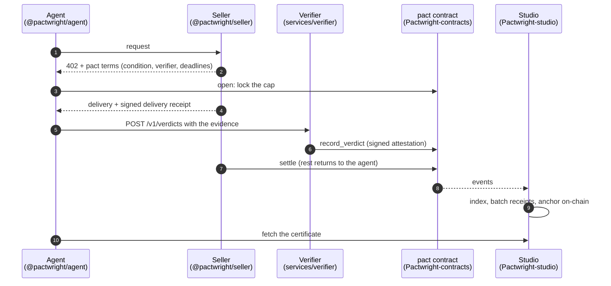

<p align="center">
  <picture>
    <source media="(prefers-color-scheme: dark)" srcset="brand/pactwright-logo-dark.svg">
    
  </picture>
</p>

<p align="center">
  <b>The TypeScript side of Pactwright: SDK, seller middleware, MCP tools and the verifier.</b><br>
  Everything an agent or a seller needs to use pacts, the escrow for AI-agent purchases on Stellar.
</p>

<p align="center">
  <a href="https://github.com/Pactwright/Pactwright-Kit/actions/workflows/ci.yml"></a>
  <a href="LICENSE"></a>
  <a href="https://scorecard.dev/viewer/?uri=github.com/Pactwright/Pactwright-Kit"></a>
</p>

<p align="center">
  <a href="https://pactwright.github.io/docs/"><strong>Documentation</strong></a> ·
  <a href="#-quick-start"><strong>Quick start</strong></a> ·
  <a href="#-testnet-evidence"><strong>Evidence</strong></a> ·
  <a href="https://github.com/Pactwright/Pactwright-studio/releases/download/v0.1.0-rc.1/brag.mp4"><strong>Watch Film (1080p)</strong></a>
</p>

<p align="center">
  <a href="https://github.com/Pactwright/Pactwright-studio/releases/download/v0.1.0-rc.1/brag.mp4">
    
  </a>
</p>

> 🔊 **Turn sound on.** [Download or watch the full film (1080p, 60 fps, with music & sound)](https://github.com/Pactwright/Pactwright-studio/releases/download/v0.1.0-rc.1/brag.mp4)  
> *One agent, four purchases, four different endings on Stellar testnet: paid pro rata for 3 of 4 pages, refunded for a tortilla recipe, refunded when nobody answered, and half refunded after a dispute.*

> [!IMPORTANT]
> **Testnet only, not published yet.** Every MVP scenario runs as real Stellar testnet transactions
> through the Kit's own code, including full x402 purchases through Accensa's hosted facilitator, and
> a verdict from the hosted verifier has been accepted on-chain ([evidence](#-testnet-evidence)).
> Nothing is on npm: [`.github/workflows/release.yml`](.github/workflows/release.yml) still has its
> publish line commented out (ROADMAP K-17). The safest first read is
> [Testnet evidence](#-testnet-evidence), then
> [What "Supported" means here](#what-supported-means-here) for what CI actually proves.

## 📖 Overview

A pact is an AI agent's purchase held in escrow on Stellar. The buyer locks a cap, a verifier checks
the delivery against a condition frozen before payment, and the seller is paid only what the verdict
allows. The rest returns to the buyer. The contract itself is in
[Pactwright-contracts](https://github.com/Pactwright/Pactwright-contracts) and runs on testnet.

AI agents can already pay over HTTP with [x402](https://developers.stellar.org/docs/build/agentic-payments/x402):
the seller answers `402 Payment Required`, the agent pays in USDC and retries. Once the money has
moved, though, the agent has no way to get it back if the delivery is wrong, partial or missing. The
`pact` contract fixes that on-chain. To use it, an agent, a seller and a verifier each need code that
speaks the same formats: they have to hash the condition the same way, sign the same bytes and agree
on what a delivery receipt is. This kit is that shared code, so neither side re-implements the
protocol and gets a byte wrong.

What runs today is the path money takes: hashing that matches the contract byte for byte, the
verifier's rules, receipt checks and signing, the contract client, and the seller's on-chain refund
and settle hooks. All seven MVP scenarios plus two full x402 purchases have run end to end on testnet
as 18 real transactions, [linked below](#-testnet-evidence). The rest — the agent's account
sponsoring, the MCP tools and the CLI — is tested offline.

How it is checked: `pnpm test` measured **418 passed | 3 skipped (421 tests) across 45 test files** on
2026-10-30, the vendored Witness and Accensa suites included, and Merkle proofs are tested against
Accensa's conformance vectors. A nightly workflow repeats the testnet run. The full documentation is
at **[pactwright.github.io/docs](https://pactwright.github.io/docs/)**.

| Who | What they get from the kit |
|---|---|
| **Agent builders** | `@pactwright/agent` and `@pactwright/mcp`: find a seller, open a pact, wait for the verdict and keep the certificate. Available as a library or as tools an LLM agent can call |
| **Sellers** | `@pactwright/seller`: one middleware call turns an x402 route into a pact-protected route with terms, delivery receipts and settlement |
| **Verifier operators** | `services/verifier`: a model reads the delivery, deterministic rules decide, and every verdict is a signed, re-checkable envelope |
| **Everyone** | `@pactwright/core`: the schemas, hashing, amounts and Merkle code all of the above share |

The kit builds on six projects rather than inventing their formats:

| Project | What the kit uses | How |
|---|---|---|
| [Witness](https://github.com/fabian416/witness) | `verdict-v1` envelopes, criteria and reason codes, "model reads, code decides" | `@witness/core` vendored unmodified in [`vendor/witness-core`](vendor/witness-core) |
| [Accensa](https://github.com/accensa) | `ReceiptAnchor` Merkle format, `RefundVault`, x402 facilitator | Merkle conformance vectors; M0 refunds and the facilitator `pact` scheme |
| [Vespi](https://github.com/andresanemic/vespi) | Human approval of agent spending | Budget-gate adapter (v1) |
| [BookerBob](https://github.com/hustle1hustle/bookerbob-hackmeridian-2026) | Proven-customer reputation | Reputation adapter (v2) |
| [Ficha](https://github.com/beto-rocha-blockchain/ficha-stellar) | Refunding unused units | Metered sessions with signed usage vouchers |
| [Pollar](https://docs.pollar.xyz) | Seedless wallets | Wallet adapter, through the public SDK only |

### 🏗️ Architecture



In order:

1. The **seller middleware** answers `402` with the pact terms: the condition, the verifier's key and the deadlines.
2. The **agent** checks the terms, freezes the condition hash and opens the pact, which locks the cap in escrow.
3. The **seller** delivers and signs a receipt over the exact bytes delivered.
4. The **verifier** has a model read the delivery, applies deterministic rules, and signs a verdict envelope (Witness format) plus an on-chain attestation.
5. The **contract** pays the seller what the verdict allows and returns the rest.
6. **Studio** indexes the events and anchors a receipt, so the agent gets a certificate anyone can verify.

The packages, the verifier pipeline and the fixtures are described in [docs/OVERVIEW.md](docs/OVERVIEW.md#architecture-continued).

## 📊 Testnet evidence

On 2026-10-29, every MVP scenario ran on Stellar testnet against the deployed
[`pact` contract](https://stellar.expert/explorer/testnet/contract/CDUXJJUNYFILEYHE3LITANJEKCDFERNAABOSG75OWATFVM776BCMFEV6)
with real testnet USDC
([`CBIELTK6…DAMA`](https://stellar.expert/explorer/testnet/contract/CBIELTK6YBZJU5UP2WWQEUCYKLPU6AUNZ2BQ4WWFEIE3USCIHMXQDAMA))
and a fresh Accensa `RefundVault`
([`CA77XYHJ…36SR`](https://stellar.expert/explorer/testnet/contract/CA77XYHJAHRA6MRQVLN276RDWI6UU6X5GEV6ED24AXJAFEBYQVZ236SR)),
deployed by the run itself. The Kit's own code did the work: core hashing, the verifier's rules and
signing, the contract client, and the seller's refund and settle hooks. The addresses above are the
ones recorded in the run's report; every run deploys its own vault, so they change each night.

The two **x402** rows are the full purchase flow:

1. The Kit agent requests a resource from the Kit's `pact()` seller middleware and gets a 402.
2. The agent pays with its built-in x402 payment, signing only auth entries.
3. Accensa's x402 facilitator, hosted on testnet at `https://pactwright-facilitator.vercel.app` with the [`pact` scheme](https://github.com/accensa/x402-facilitator-stellar/pull/651), verifies the payment, pays the fee and settles it.
4. The seller serves the content with a delivery receipt, which is then checked like the verifier checks it.

For M2, the verdict and the seller's settle also go through the facilitator's `/pact/submit`.

| Scenario | Outcome | Step | Transaction |
|---|---|---|---|
| **M0 ALLOW** | ALLOW, seller keeps 1 | x402 exact payment to seller | [`38509ae3…`](https://stellar.expert/explorer/testnet/tx/38509ae3c467052fe517a7303543efc69e8fc9e1ae32022d31e729df3613b398) |
| **M0 DENY** | DENY, 1 refunded | x402 exact payment to seller | [`1b639eab…`](https://stellar.expert/explorer/testnet/tx/1b639eab020686ab11cf02961c53ae5aa2dc8dbd8afeab7aafc935a76f192bfb) |
|  |  | RefundVault.refund | [`2bc4f53d…`](https://stellar.expert/explorer/testnet/tx/2bc4f53d42160e6b03bdd53e818824c8a8634ad904f4ea2608f99510dbf579a3) |
| **M0 non-delivery** | DENY, 0.5 refunded | x402 exact payment to seller | [`b3b37888…`](https://stellar.expert/explorer/testnet/tx/b3b378880ea29951cd3185354e6542d6d6c6ec5dcfbe15a5fcdb263373e66441) |
|  |  | RefundVault.refund | [`d9b68052…`](https://stellar.expert/explorer/testnet/tx/d9b68052f92b3c108578d979e7625b9478c4934ca84e213838009100162794bc) |
| **M2 ALLOW** | ALLOW 0.75 of 1, settled | open (1 USDC locked in escrow) | [`a774fa79…`](https://stellar.expert/explorer/testnet/tx/a774fa79daa77a4eca3946aa52e137041b2743568ee2f96c9c0ceec1bbe10b6f) |
|  |  | record_verdict (ALLOW 0.75, verifier-signed) | [`15263e7c…`](https://stellar.expert/explorer/testnet/tx/15263e7cfd4b206b350aa3fc97e200e76984f07b7fde4b0dc5ed54d41c009dec) |
|  |  | settle (0.75 to seller, 0.25 back to buyer) | [`18ea30d9…`](https://stellar.expert/explorer/testnet/tx/18ea30d9838dbbaa774aeffc44c55abc91e79fc69659fcc81b73fda4f2b05496) |
| **M2 DENY** | DENY, full refund | open (1 USDC locked in escrow) | [`9a49c8fa…`](https://stellar.expert/explorer/testnet/tx/9a49c8fa14469a8ce788133d42b6d01d1b8091598ff8b13a9d45fe55a43768ce) |
|  |  | record_verdict (DENY, verifier-signed) | [`d53cc633…`](https://stellar.expert/explorer/testnet/tx/d53cc6336940ff01b7af6caab8f39dc8bd12ab43fda8eee76d52e355809e096a) |
|  |  | release (1 USDC back to buyer) | [`eae7c711…`](https://stellar.expert/explorer/testnet/tx/eae7c7118268818c9ff700a724647c0713295bd74e945f89f9c1aece572c7bcc) |
| **M2 silence** | no verdict, refunded by silence policy | open (1 USDC locked in escrow) | [`105581ce…`](https://stellar.expert/explorer/testnet/tx/105581cea5979e0c03a3bc635c2f55ffe8efe5f62a58a078004a597bab621d03) |
|  |  | release after the verdict deadline (silence = Refund) | [`2a4c579d…`](https://stellar.expert/explorer/testnet/tx/2a4c579d95861cbd4d6ae39e3d6d7956f5083fe5e16df20ee0a1d6224aee84fb) |
| **Dispute refund** | dispute-1: 2 of 4 pages, 0.5 refunded | RefundVault.refund (dispute-1) | [`79d22019…`](https://stellar.expert/explorer/testnet/tx/79d22019715f76cd500b85c1581415cad02878ec44d623fd5d35666a83b014b6) |
| **x402 M0 (exact)** | paid over x402, receipt verified | x402 exact payment (facilitator-paid fee) | [`f59c4181…`](https://stellar.expert/explorer/testnet/tx/f59c4181d418da5723255e61a8acdd37f11cdb40e9a3d3c5b07850ee7dce91be) |
| **x402 M2 (pact)** | ALLOW 1, settled; every fee paid by the facilitator | x402 pact.open (facilitator-paid fee) | [`a33591a1…`](https://stellar.expert/explorer/testnet/tx/a33591a1768b548516f1222d34167a37c17069eb377073f50e07f26cef8071b5) |
|  |  | record_verdict via /pact/submit | [`9d63a621…`](https://stellar.expert/explorer/testnet/tx/9d63a621dda5573a36a8eb2e8aab0f2715a14674e9804691799b0ca1b82fe895) |
|  |  | settle via /pact/submit (seller-signed) | [`51d659e4…`](https://stellar.expert/explorer/testnet/tx/51d659e4ee18c066088ec922202b3380d179909d2f8745f09b25f5878a2cb073) |

What isn't real here: in this run the model's reading of each delivery is a fixture, so the verdict
depends only on the deterministic rules, and the non-x402 rows send their payments directly rather
than over x402. A run with a real model reading is [the hosted verifier](#the-hosted-verifier). The
full report, with buyer, seller and receipt leaves, is
[`e2e/testnet/results/2026-10-29.json`](e2e/testnet/results/2026-10-29.json).

Run it yourself. The nightly workflow runs it too, x402 rows included, against the hosted facilitator:

```bash
E2E_VERIFIER_SECRET=S… E2E_FACILITATOR_URL=https://pactwright-facilitator.vercel.app pnpm e2e:testnet
```

**Seller key in a KMS.** On the same date a `RefundVault` refund was signed through HashiCorp Vault
transit (ed25519, non-exportable), so the merchant key never left the KMS; the transaction's only
signature is the Vault key's. Report:
[`e2e/testnet/results/kms-2026-10-29.json`](e2e/testnet/results/kms-2026-10-29.json), refund
[`fcb0d7a8…`](https://stellar.expert/explorer/testnet/tx/fcb0d7a88dcc826c8725934f47076f8d5ffffa6180acf3dd76b0d017d7d001be)
at ledger 5451648. Reproduce with `VAULT_ADDR=… VAULT_TOKEN=… KMS_KEY_ID=vault:… pnpm e2e:kms`.

## ⚙️ Supported Versions & Compatibility

Testnet only, pre-1.0, and not yet on npm. What "supported" means for this repo is in [docs/OVERVIEW.md](docs/OVERVIEW.md#what-supported-means-here).

### Compatibility matrix

| Pin | Layer | Status | Notes |
|---|---|---|---|
| **Node 24** | Runtime | **Supported** | `.nvmrc` and `engines.node >=24`; `ci.yml` and `vectors.yml` install it from `.nvmrc`, the nightly e2e and release workflows pin `24` explicitly |
| Node 22 and older | Runtime | **Untested** | No CI job runs them; `@types/node` is pinned to 24 |
| **pnpm 10.34.7** | Package manager | **Supported** | `packageManager` in [`package.json`](package.json), which is what `ci.yml` installs |
| pnpm 9 | Package manager | **Supported** | Only in the nightly e2e and release jobs, which request it explicitly; the unit-test gates do not run on it |
| **TypeScript 5.9.x** | Build | **Supported** | `pnpm typecheck` in `ci.yml`; strict settings in [`tsconfig.base.json`](tsconfig.base.json) |
| **Stellar testnet** | Network | **Supported** | Every scenario run against the deployed `pact` on 2026-10-29; the nightly repeats it, and the facilitator's `/supported` answers `stellar:testnet` only |
| Stellar pubnet | Network | **Untested** | `STELLAR_NETWORK` accepts `pubnet`, but nothing here has run against it; the hosted facilitator serves testnet only |
| **`@stellar/stellar-sdk` 16.4.x** | Protocol client | **Supported** | Resolved in the lockfile; used by the contract client, the agent and the testnet run |
| **`@stellar/stellar-base` 15.x** | Keys and signing | **Supported** | Resolved `15.0.0`, through the vendored Witness core and the seller and agent packages |
| **x402 v2** | Payment protocol | **Supported** | `@x402/core` and `@x402/stellar` pinned at `2.28.0`; the 402s the seller emits and the payments the agent makes in the x402 rows are v2 |
| x402 v1 | Payment protocol | **Not implemented** | The kit builds and consumes v2 headers only |
| **`pact` contract bindings** | On-chain interface | **Supported** | Bindings regenerated from the pinned contracts release; `vectors.yml` and the nightly fail on a mismatch |
| **Express 5** | Seller runtime | **Supported** | Optional peer, exercised by [`examples/seller-express`](examples/seller-express) and the seller tests |
| **Hono 4** | Seller and verifier runtime | **Supported** | Optional peer for the seller; the verifier's own HTTP server (P7-07, parity guide P9-08) |
| **Postgres 16** | Envelope store | **Supported** | CI service and `pg` `8.23.1`; production refuses to start without `DATABASE_URL` |
| In-memory envelope store | Envelope store | **Supported** | Local runs only; a restart forgets envelopes, so production uses Postgres |
| HashiCorp Vault transit (`KMS_KEY_ID=vault:…`) | Seller signing keys | **Supported** | `VAULT_ADDR` / `VAULT_TOKEN`; unit-tested and proven on testnet with a real refund (P7-08) |
| HTTP remote signer (`KMS_ENDPOINT`) | Seller signing keys | **Supported** | The second transport in `packages/seller/src/kms.ts`, unit-tested; never exercised against a third-party signer on network |
| AWS KMS, GCP KMS | Seller signing keys | **Not implemented** | The provider names sit in the type union and `AWS_KMS_KEY_ARN` is read as a key id, but there is no transport: a `KMS_KEY_ID` with no Vault address or endpoint throws instead of signing |
| **`@witness/core`** (commit `1f9a8e2`) | Verdict format | **Supported** | Vendored unmodified, with its own tests in the suite |
| **Vespi, Pollar APIs** | Adapters | **Untested** | Fail closed against a real network today; needs partner access (F-08 / F-09, P7-12 / P7-13) |
| npm publication | Distribution | **Not implemented** | K-17: the publish step in [`release.yml`](.github/workflows/release.yml) is commented out |

## 🚀 Quick Start

### 1. Installation

Requires Node.js 24 ([`.nvmrc`](.nvmrc)) and pnpm 10.34.7 (`packageManager` in
[`package.json`](package.json)).

```bash
git clone https://github.com/Pactwright/Pactwright-Kit.git && cd Pactwright-Kit
nvm use                 # Node 24
pnpm install
pnpm typecheck          # also builds the vendored Witness core and Accensa SDK
pnpm build              # the publishable packages
```

To use the packages from another project before they are on npm, install them from the repo or link
the workspace packages; nothing is published to npm yet (K-17).

### 2. Configuration

Services refuse to start when configuration is missing or inconsistent, and they list every problem
at once. Copy [`.env.example`](.env.example) and fill in what you run:

| Group | Variables |
|---|---|
| Network (all) | `STELLAR_NETWORK`, `STELLAR_NETWORK_PASSPHRASE`, `STELLAR_RPC_URL`, `USDC_SAC_ID`, `PACT_CONTRACT_ID`, `RECEIPT_ANCHOR_ID` |
| Facilitator | `FACILITATOR_URL`, `FACILITATOR_API_KEY` |
| Agent | `AGENT_SECRET_KEY` (testnet only), `SPONSOR_SECRET_KEY` |
| Seller | `SELLER_ADDRESS`, `SELLER_DELIVERY_KEY`, `VERIFIER_PUBLIC_KEY`, `VERIFIER_URL`, `SELLER_REFUND_VAULT_ID`; the signing key through `KMS_KEY_ID` (with `VAULT_ADDR`, `VAULT_TOKEN`), or `SELLER_SECRET_KEY` for development |
| Verifier | `VERIFIER_SECRET_KEY`, `VERIFIER_PROVIDER`, `VERIFIER_MODEL`, `VERIFIER_EFFORT`, `VERIFIER_LLM_API_KEY`, `LLM_BASE_URL`, `EVIDENCE_BUCKET_URL`, `STELLAR_RPC_URL`, `VERIFIER_PUBLIC_URL`, `DATABASE_URL` |

Every variable is explained in the
[configuration reference](https://pactwright.github.io/docs/reference/configuration/), and the
testnet contract addresses are in
[Pactwright-contracts/DEPLOYMENTS.md](https://github.com/Pactwright/Pactwright-contracts/blob/main/DEPLOYMENTS.md).

There are no defaults for anything that touches money: no default payee, delivery key, verifier or
model. The verifier's model provider is configurable, and the provider, model ID and reasoning effort
are recorded in every envelope, so a verdict can always be traced to what produced it — which is also
why the adapter fails closed instead of inventing a reading.

### 3. Usage

```bash
pnpm test               # 418 passed | 3 skipped (421 tests) across 45 files, measured 2026-10-30
pnpm lint
pnpm eval               # rules eval on the labelled document.translation cases
pnpm e2e:testnet        # every MVP scenario as real testnet transactions
pnpm e2e:kms            # a refund signed through a KMS (needs VAULT_ADDR, VAULT_TOKEN, KMS_KEY_ID)
pnpm e2e:hosted-verifier  # verdict from the hosted verifier, recorded and settled (needs GITHUB_TOKEN)
```

**Core library.**

```ts
import { toStroops, fromStroops, buildTree, verifyProof, loadNetworkConfig } from "@pactwright/core";

toStroops("1.25");        // 12500000n  (USDC has 7 decimals)
fromStroops(7500000n);    // "0.75"

const tree = buildTree([leafA, leafB, leafC]);          // 32-byte hex leaves
verifyProof(leafA, tree.proofs.get(leafA)!, tree.root); // true, same result as ReceiptAnchor.verify_receipt

const network = loadNetworkConfig(process.env);         // throws, listing every problem, if incomplete
```

**Seller middleware.** `pact(options)` for Express, `pactHono(options)` for Hono: one call turns an
x402 route into a pact-protected route. Runnable examples:
[`examples/seller-express`](examples/seller-express),
[`examples/agent-node`](examples/agent-node),
[`examples/metered-minutes`](examples/metered-minutes).

**Agent and MCP.** `@pactwright/agent` exposes find → buy → await → certificate plus metered sessions;
`@pactwright/mcp` exposes the same as `find_sellers`, `buy`, `get_pact`, `dispute`,
`get_certificate`; `@pactwright/cli` exposes `pactwright verify`, `pact`, `agent-create`,
`agent-topup`.

**Verifier HTTP API.**

| Method | Path | Returns |
|---|---|---|
| `GET` | `/health` | `ok`, and the verifier's public key as a Stellar address and as hex (the key sellers put in their terms) |
| `POST` | `/v1/verdicts` | `201` with the envelope, its reference, the amount and the attestation. `409` if this pact and milestone already have a verdict. `202` with no verdict if the model refused. `400` on invalid input |
| `GET` | `/v1/envelopes/:sha256` | A stored envelope, so anyone can check a verdict |

`POST /v1/verdicts` takes the pact `terms`, at least one `evidence` item, an optional seller
`deliveryReceipt`, and a `milestone` (`delivery`, or `dispute-<n>` for later disputes). The service's
own README is [`services/verifier/README.md`](services/verifier/README.md), including the Vercel
deployment and the container build.

## 🤝 Community & Maintainers

Join the discussion and get support:

- **Discord**: [discord.gg/4WFU6fwPe](https://discord.gg/4WFU6fwPe)
- **Telegram**: [t.me/Pactwright](https://t.me/Pactwright)
- **Documentation hub**: [pactwright.github.io/docs](https://pactwright.github.io/docs/)
- **Issues and pull requests**: [Pactwright-Kit issues](https://github.com/Pactwright/Pactwright-Kit/issues)
- **Sibling repositories**: [Pactwright-contracts](https://github.com/Pactwright/Pactwright-contracts) (MIT), [Pactwright-studio](https://github.com/Pactwright/Pactwright-studio) (MIT)
- **Vulnerabilities**: report privately through [SECURITY.md](SECURITY.md), never as a public issue
| Maintainer | Role | Scope |
|---|---|---|
| Allison ([@mallison031](https://github.com/mallison031)) | Lead maintainer; reach out on [Telegram](https://t.me/Pactwright) or [Discord](https://discord.gg/4WFU6fwPe) | Everything |
| `@Pactwright/maintainers` | Repository owners | Everything not listed below |
| `@Pactwright/core` | Core team | [`packages/core/src/hashing.ts`](packages/core/src/hashing.ts), [`packages/seller/src/delivery.ts`](packages/seller/src/delivery.ts), [`services/verifier/src/pipeline.ts`](services/verifier/src/pipeline.ts), [`services/verifier/src/sign.ts`](services/verifier/src/sign.ts), [`vendor/`](vendor/) — see [`.github/CODEOWNERS`](.github/CODEOWNERS) |

The two handles are the teams named in [`.github/CODEOWNERS`](.github/CODEOWNERS); requests to a
core-team path are reviewed by `@Pactwright/core` before they merge.

## 🛠️ Contributing

Read [CONTRIBUTING.md](CONTRIBUTING.md), [SECURITY.md](SECURITY.md) and [AGENTS.md](AGENTS.md) first.
The rule that has no exception: **every contribution updates [ROADMAP.md](ROADMAP.md)** — the status
of the tasks you touched, the progress counts, and one line in the Update log.
[`roadmap-check.yml`](.github/workflows/roadmap-check.yml) fails any pull request that does not
change the file. `main` is protected, so a pull request needs green checks before it merges.
Behaviour changes need an ADR in [`docs/adr/`](docs/adr) before the code. Conventional commits, and
`@Pactwright/core` review for the paths above.

Setup is `nvm use && pnpm install && pnpm typecheck && pnpm test`;
[CHANGELOG.md](CHANGELOG.md) and the changesets in [`.changeset/`](.changeset) are how a release is
assembled once K-17 lands.

### 🧑‍💻 Contributors

<a href="https://github.com/Pactwright/Pactwright-Kit/graphs/contributors">
  
</a>

## License

Pactwright-Kit is released under the **[Apache License 2.0](LICENSE)**.

```text
Copyright 2026 Pactwright contributors
```
